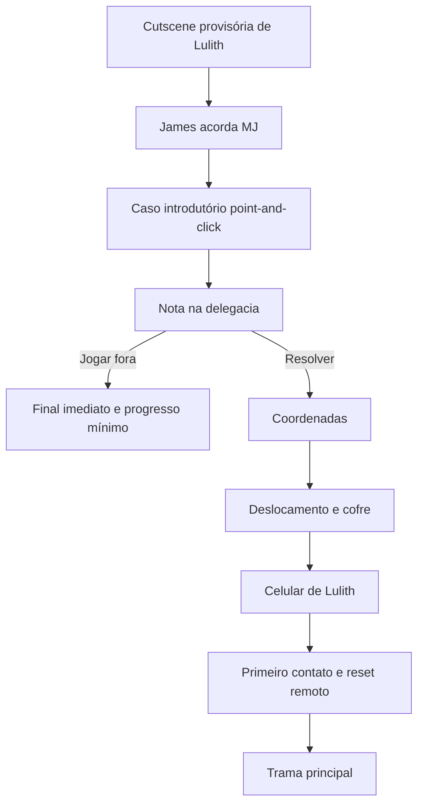
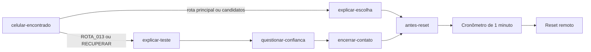
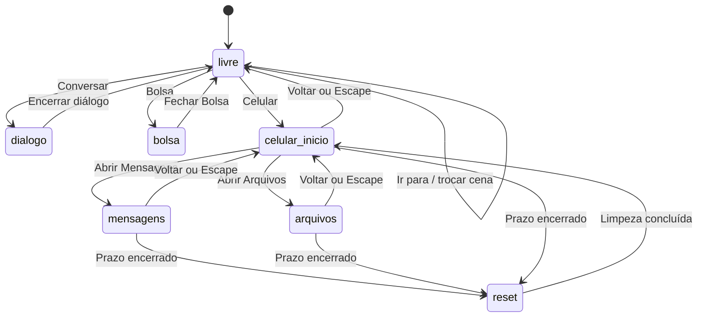

---
aliases:
  - Estrutura Gaming
  - Arquitetura do Jogo
  - Estado Atual do SANMD
tags:
  - sanmd
  - arquitetura
  - gameplay
  - roadmap
  - visual-novel
  - obsidian
status: atual
updated: 2026-09-11
---

# Estrutura Gaming

> [!summary] Objetivo
> Esta nota documenta o que funciona atualmente em **Sim, Acredite nas Mentiras Dele kk**, explica sua arquitetura e organiza a evolução do protótipo em formato de roadmap. O código é a fonte de verdade; recursos descritos no [[GDD]] que ainda não possuem implementação são identificados como planejamento.

## Navegação

- [[ESTRUTURA_GAMING#Visão Geral|Visão Geral]]
- [[ESTRUTURA_GAMING#Direção Conceitual Atual|Direção Conceitual Atual]]
- [[ESTRUTURA_GAMING#Roadmap Do Fluxo Atual|Roadmap Do Fluxo Atual]]
- [[ESTRUTURA_GAMING#Arquitetura Técnica|Arquitetura Técnica]]
- [[ESTRUTURA_GAMING#Máquina De Estados|Máquina De Estados]]
- [[ESTRUTURA_GAMING#Visual Novel E Diálogos|Visual Novel E Diálogos]]
- [[ESTRUTURA_GAMING#Controles E Botões|Controles E Botões]]
- [[ESTRUTURA_GAMING#Interface Do Celular|Interface Do Celular]]
   - [[ESTRUTURA_GAMING#Aplicativo Mensagens|Aplicativo Mensagens]]
   - [[ESTRUTURA_GAMING#Entrada de texto e teclado virtual|Entrada de texto e teclado virtual]]
   - [[ESTRUTURA_GAMING#Sistema de Save e Load|Sistema de Save e Load]]
- [[ESTRUTURA_GAMING#Expressões fotográficas da MJ|Expressões fotográficas da MJ]]
- [[ESTRUTURA_GAMING#Timers E Ritmo|Timers E Ritmo]]
- [[ESTRUTURA_GAMING#Interface E Acessibilidade|Interface E Acessibilidade]]
- [[ESTRUTURA_GAMING#Execução E Android|Execução E Android]]
- [[ESTRUTURA_GAMING#Matriz De Funcionalidades|Matriz De Funcionalidades]]
- [[ESTRUTURA_GAMING#Limitações Atuais|Limitações Atuais]]
- [[ESTRUTURA_GAMING#Roadmap Futuro|Roadmap Futuro]]
- [[ESTRUTURA_GAMING#Validação Pendente|Validação Pendente]]

## Visão Geral

O projeto atual é um protótipo de Visual Novel investigativa feito com HTML, CSS e JavaScript. Ele possui três cenas provisórias navegáveis no beco, um sistema de diálogo, monólogos que mudam conforme o progresso e uma interface de celular usada como canal narrativo.

### O Que Funciona

- Três cenas noturnas provisórias: entrada, interior e fundo do beco.
- Sprite genérico e estático de MJ em PNG externo (`assets/sprites/MJ.png`).
- MJ aparece em cena somente durante os monólogos (sala sem personagens presenciais).
- Transição animada de entrada e saída de MJ.
- Comandos por ícone para **Conversar**, **Ir para**, **Celular** e **Bolsa**, sem sidebar visual.
- Menu contextual minimalista de destinos, associado ao ícone **Ir para**.
- Caixa de diálogo inspirada em *Ace Attorney* (fundo claro, placa de nome com ponta e contorno marcado).
- Efeito de digitação com som sintetizado por letra.
- Monólogos condicionados ao progresso da conversa.
- Tela inicial do celular com relógio e data reais.
- Aplicativo Mensagens funcional.
- Galeria com até nove saves manuais, Load e exclusão, além de um autosave separado.
- Dez expressões fotográficas transparentes da MJ, independentes da pose narrativa.
- Aplicativo Arquivos com primeiro enigma e registros opcionais anteriores ao reset.
- Respostas selecionáveis com ramificações curtas.
- Cooldown antes da primeira resposta do dono.
- Indicador `digitando...`.
- Entrega individual das mensagens do dono.
- Histórico do caminho escolhido durante a sessão.
- Primeiro contato canônico com Lulith e reset remoto do aparelho.
- Arquivamento interno das pistas vistas e do chat antes do reset.
- Rotas de conversa e monólogos condicionados aos arquivos examinados.
- Cronômetro vermelho de um minuto antes da limpeza remota.
- Navegação contextual pelo botão **Voltar** e pela tecla `Escape`.
- Layout responsivo para telas menores.
- Projeto Android e comando de build de APK com Capacitor.

### Escopo Atual

O protótipo valida a base da experiência, não o jogo completo. A interface do celular, a apresentação narrativa e a transição entre estados são o foco desta versão.

A cena ainda é um contexto provisório que começa com o celular em posse de MJ. A conversa, os monólogos, os arquivos anteriores ao reset, a limpeza remota, a investigação point-and-click, a Bolsa e a ativação do aparelho já representam um recorte canônico da Fase 8 do Ato I; as etapas anteriores, da abertura à obtenção do aparelho, ainda não estão implementadas.

> [!warning] Fonte de verdade
> O [[IDEIA_CONCEITUAL]] registra as decisões narrativas mais recentes. O [[GDD]] organiza o design do jogo. Investigação, terminal, puzzles, múltiplos atos, finais, replay e ARG fazem parte da visão futura e não estão presentes no código atual.

## Direção Conceitual Atual

### Premissa Canônica Planejada

MJ é uma investigadora criminal/consultora técnica ligada à polícia em São Paulo. Após um caso introdutório, ela encontra uma nota na delegacia. Resolver seu enigma leva a coordenadas, a um cofre e ao celular de Lulith; jogar a nota fora encerra a partida imediatamente com progresso mínimo.



### Personagens Definidos

| Personagem | Função atual |
|---|---|
| MJ | Protagonista; nome escolhido pelo jogador; experiente em enigmas, ARGs e escape rooms |
| Lulith | Dona do celular e responsável por conduzir os testes |
| William James | Amigo, antigo professor e colega de trabalho de MJ |

O elenco terá no máximo seis personagens principais/relevantes. Não haverá romance entre MJ e Lulith.

### Sistemas Planejados Do Celular

| Aplicativo | Função planejada | Status atual |
|---|---|---|
| Mensagens | Conversas com Lulith e escolhas narrativas | Primeiro contato canônico e anônimo funcional |
| Galeria | Fotografias, gravações e pistas | Save/Load fotográfico implementado; gravações e pistas futuras |
| Câmera | Registro e save por fotografia | Captura integrada à Galeria; sem aplicativo separado ou screenshot real |
| Notas | Informações contextuais | Removido da tela inicial; sem implementação |
| Arquivos | Documentos e conteúdo oculto | Quatro registros pré-reset; vazio após a limpeza |
| Terminal | Puzzles e acesso a informações escondidas | Não implementado |
| Mapa | Coordenadas, locais e deslocamento | Não implementado |
| Progresso | Percentual da investigação reconstruída | Não implementado |
| Salvamento/replay | Retomada e novas perspectivas | Save/Load manual e autosave implementados; replay pendente |

### Direção Visual

A versão final manterá direção pixelada e personagens 2D expressivos. Os assets dos Protótipos 1 e 2 serão genéricos; o design canônico será fechado apenas no Protótipo 3. Os protótipos atuais usarão tudo em 2D, enquanto a dimensionalidade final dos cenários continua pendente.

## Roadmap Do Fluxo Atual

Este roadmap descreve a sequência que já funciona durante uma partida.

### Etapa 1 — Inicialização

1. `index.html` monta a cena, os três controles sobrepostos e o celular oculto.
2. `js/data.js` disponibiliza locais, cenas, destinos, monólogos e árvore de mensagens.
3. `js/save-system.js` disponibiliza o repositório de persistência; `js/bootstrap.js` compõe os serviços e cria o estado inicial em modo `livre`.
4. **Conversar**, **Ir para** e **Celular** ficam disponíveis conforme o estado e os destinos da cena.

### Etapa 2 — Cena Livre

O jogador vê o beco e pode escolher uma das três ações principais:

- **Conversar:** inicia uma interação local.
- **Ir para:** abre os destinos ligados à cena atual.
- **Celular:** abre o aparelho em uma camada sobre o cenário.

Enquanto um diálogo ou o celular está aberto, os três botões principais ficam desabilitados e o menu de destinos é fechado.

### Etapa 3 — Monólogo Inicial

Como `DATA.cena.personagensPresentes` está vazio nas cenas atuais, **Conversar** não encontra um personagem presencial. O sistema usa o monólogo correspondente à cena e à fase de progresso.

### Etapa 4 — Abertura Do Celular

O celular abre sempre na tela inicial e apresenta:

- Hora local.
- Data local.
- Sinal e bateria decorativos.
- Mensagens.
- Galeria.
- Arquivos.

**Mensagens**, **Galeria** e **Arquivos** possuem comportamento implementado. A Galeria cria, carrega e exclui saves fotográficos. Mensagens fica acessível desde o início. Três arquivos podem liberar opções condicionais durante a conversa; `REMETENTE.enc` aparece somente quando a conversa termina e o cronômetro do reset começa. Após a limpeza, os dois aplicativos continuam acessíveis, mas não exibem conteúdo.

### Etapa 5 — Primeira Mensagem Do Protagonista

Ao entrar em Mensagens pela primeira vez, nenhuma mensagem do dono é mostrada. O jogador escolhe entre as opções básicas e aquelas liberadas pelos arquivos examinados, e o protagonista envia a primeira mensagem.

Nesse momento:

- A escolha entra no histórico à direita.
- As opções são ocultadas.
- O monólogo muda para `aposPrimeiroEnvio`.
- Se a escolha for condicional, sua rota de monólogo é preservada sem poder ser substituída por outra rota individual.
- Começa um cooldown de 1 minuto.

### Etapa 6 — Resposta Do Dono

Quando o cooldown termina:

1. Aparece `digitando...`.
2. A primeira mensagem chega após 1,2 segundo.
3. As demais mensagens chegam individualmente.
4. Cada mensagem também respeita o intervalo de 1,2 segundo.
5. Ao terminar a fila, novas respostas do protagonista são liberadas.

### Etapa 7 — Ramificações Curtas

O jogador sempre pode seguir uma rota principal curta, mas arquivos específicos liberam opções e rotas adicionais. `CANDIDATOS_04.log` libera uma pergunta sobre candidatos; `ROTA_013.txt` libera a rota sobre a origem do aparelho; `RECUPERAR.tmp` libera uma cobrança direta. Essas rotas entregam informações diferentes antes de convergirem para `antes-reset`. O cabeçalho permanece como `???`, e o contato não revela nome, gênero ou dados pessoais.



### Etapa 8 — Conclusão

Depois da última resposta do contato:

- A etapa do chat passa a `null`.
- Nenhuma nova opção é apresentada.
- Um cronômetro vermelho de um minuto aparece no canto superior esquerdo do celular.
- O último arquivo fica disponível durante essa janela.
- O histórico e os IDs dos arquivos vistos são arquivados internamente quando o reset começa.
- Uma tela de reset bloqueia temporariamente a navegação.
- O histórico visível é apagado e Arquivos passa a exibir uma lista vazia.
- O monólogo muda para `conversaConcluida` somente depois que a limpeza termina.
- **Conversar** passa a apresentar a reflexão final do protagonista.

## Arquitetura Técnica

### Mapa De Arquivos

```text
.
├── index.html                 # Estrutura da cena e do celular
├── styles.css                 # Layout, animações e responsividade
├── js/
│   ├── bootstrap.js           # Composição e injeção de dependências
│   ├── title-menu.js          # Tela inicial: capa do caderno e páginas de registros
│   ├── config.js              # Configurações globais (tamanhos, temas, etc.)
│   ├── data.js                # Conteúdo narrativo e árvore do chat
│   ├── state.js               # Estado centralizado do jogo
│   ├── dom.js                 # Acesso agrupado ao DOM por componente
│   ├── events.js              # Eventos globais (teclado, redimensionamento)
│   ├── bag.js                 # Fábrica da Bolsa (inventário)
│   ├── dialogue.js            # Fábrica de diálogos e monólogos
│   ├── monologues.js          # Conteúdo dos monólogos por contexto
│   ├── phone.js               # Fábrica do celular (apps, tema, navegação)
│   ├── scene.js               # Fábrica de cena (fundos, hotspots, objetos)
│   ├── gallery.js             # Fábrica da Galeria (fotografias, save/load)
│   ├── persistence.js         # Persistência de saves (indexedDB/localStorage)
│   ├── save-system.js         # Sistema de saves manuais e autosave
│   ├── interface.js           # Fábrica da interface principal (botões, menus)
│   ├── keyboard.js            # Teclado virtual próprio do jogo
│   └── text-entry.js          # Controlador compartilhado de entrada de texto
├── assets/                    # Arte-fonte provisória
│   ├── cenario/               # Fundos navegáveis e contrato em README.md
│   ├── interfaces/            # Ícones principais e contrato em README.md
│   └── sprites/               # Sprites de runtime e contrato em README.md
├── android/                   # Projeto nativo Android
├── capacitor.config.json      # Configuração Capacitor
├── package.json               # Scripts e dependências
├── README.md                  # Visão geral do projeto
├── TODO.md                    # Implementação e validações pendentes
├── IDEIA_CONCEITUAL.md        # Decisões narrativas e visuais mais recentes
├── GDD.md                     # Visão de longo prazo do jogo
├── docs/
│   ├── ADR_LOG.md             # Registro de decisões de arquitetura
│   ├── PHONE_THEMES.md        # Contrato de temas visuais do celular
│   ├── POINT_AND_CLICK.md     # Guia de point-and-click e Bolsa
│   ├── SAVE_SYSTEM.md         # Contrato de persistência e saves
│   ├── SCENE_TRANSITIONS.md   # Contrato das transições globais de cena
│   └── TEXT_INPUT.md          # Documentação do teclado virtual e entrada de texto
└── ESTRUTURA_GAMING.md        # Esta nota central
```

### Camadas

   | Camada | Arquivo | Responsabilidade |
   |---|---|---|
   | Estrutura | [index.html](index.html) | Cena, controles, celular e regiões acessíveis |
   | Apresentação | [styles.css](styles.css) | Visual, animações, balões e responsividade |
   | Dados | [js/data.js](js/data.js) | Cena, monólogos, etapas e respostas |
   | Domínio | [js/bootstrap.js](js/bootstrap.js) | Composição e injeção de dependências do jogo |
   | Distribuição | [capacitor.config.json](capacitor.config.json) | Empacotamento web para Android |

   ### Princípio Atual

   Não há framework de interface, bundler ou backend. O navegador carrega os scripts diretamente. O estado existe somente em memória e o DOM é atualizado por funções nos módulos de domínio. O jogo é composto por fábricas independentes que recebem dependências via `criarJogo()` em `bootstrap.js`.

## Máquina De Estados

### Estado Principal



`state.modo` controla os modos globais:

- `livre`.
- `dialogo`.
- `bolsa`.
- `celular`.

### Estado Agrupado

O estado é dividido por domínio:

```js
const state = {
  modo: "livre",
  aparelho: { originalPhoneStatus: "broken", activePhone: null, phoneTheme: "lulith" },
  inventoryActionPending: null,
  inventory: [],
  sceneState: {},
  bolsa: {
    pagina: 1,
    pesquisa: "",
    itemSelecionadoId: null
  },
  localizacao: {},
  dialogo: {},
  celular: {},
  arquivos: {},
  mensagens: {}
};
```

### Estado Do Diálogo

| Propriedade | Uso |
|---|---|
| `linha` | Índice da fala atual |
| `digitando` | Indica se o efeito de texto está ativo |
| `timer` | Intervalo do efeito de digitação |
| `falas` | Sequência em execução |
| `faseMonologo` | Seleciona o monólogo narrativo atual |
| `rotaMonologoArquivo` | Preserva a primeira rota condicional escolhida |

### Estado Do Celular

| Propriedade | Uso |
|---|---|
| `tela` | `inicio`, `mensagens`, `arquivos` ou `reset` |
| `relogio` | Intervalo de atualização da hora |
| `transicao` | Timer da animação de fechamento |
| `resetTimer` | Timer para início ou conclusão da limpeza |
| `resetInterval` | Intervalo visual do cronômetro |
| `resetAte` | Horário absoluto do início do reset |
| `resetStatus` | `inativo`, `agendado`, `executando` ou `concluido` |

### Estado Dos Arquivos

| Propriedade | Uso |
|---|---|
| `vistos` | IDs examinados durante a sessão |
| `vistosAntesReset` | Snapshot dos IDs examinados antes da limpeza |
| `enigmaIdentidadeResolvido` | Controla pronome e rota completa |
| `enigmaIdentidadeResolvidoAntesReset` | Preserva a solução no snapshot pré-reset |

### Estado Das Mensagens

| Propriedade | Uso |
|---|---|
| `etapa` | Etapa atual do chat |
| `historico` | Mensagens do caminho percorrido |
| `donoRespondendo` | Bloqueia escolhas durante a resposta |
| `donoDigitando` | Controla o indicador de digitação |
| `fila` | Mensagens ainda não entregues |
| `proximaEtapa` | Destino após a fila |
| `cooldownAte` | Horário absoluto do fim do cooldown |
| `timer` | Timer do cooldown ou do próximo envio |
| `historicoAntesReset` | Preserva internamente o chat apagado pelo reset |

### Estado Da Bolsa

| Propriedade | Uso |
|---|---|
| `pagina` | Página atual da grade de itens |
| `pesquisa` | Filtro de texto aplicado ao inventário |
| `itemSelecionadoId` | ID do item em detalhe |

`state.inventory` guarda IDs únicos. `state.inventoryActionPending` armazena a ação direta em execução. `state.sceneState[sceneId]` armazena flags persistentes por cena.

### Estado Da Localização

`state.localizacao` separa o local atual da cena atual. O local `beco` contém `beco_entrada`, `beco_interior` e `beco_fundo`; cada cena declara seus próprios destinos em `js/data.js`. `obterDestinos()` resolve somente conexões válidas e `irPara()` rejeita saltos que não estejam declarados na cena atual. `state.sceneState` armazena flags como `safeOpened` e `lulithPhoneCollected`.

## Visual Novel E Diálogos

### Seleção Da Interação

`iniciarConversa()` consulta o primeiro item de `DATA.cena.personagensPresentes`.

- Se existir um personagem, procura uma conversa em `DATA.conversas.presenciais`.
- Se não existir, usa o monólogo da fase atual.

Atualmente:

```js
personagensPresentes: []
conversas: {
  presenciais: {}
}
```

Portanto, somente os monólogos são jogáveis.

### Apresentação Do Diálogo

A caixa de diálogo segue a linguagem visual inspirada em *Ace Attorney*:

- Fundo claro (`#d9d6cf`) com texto escuro (`#16181f`), cantos retos.
- Borda marcada de `4px` e sombra deslocada `6px 6px 0` (duro, sem difusão).
- Placa de nome (`#name-plate`) em azul-escuro (`#1a3d4f`) com triângulo `::after` apontando para a caixa.
- Seta de continuação (`▼`) piscando quando a fala está pronta.

### Personagem Em Cena

MJ fica oculta por padrão. O sprite carregado é `assets/sprites/MJ.png` (`js/data.js`), na pose `neutral` e no slot `center`:

- `mostrarPersonagem("mj", "neutral", "center")` remove `oculto`, aplica `.personagem-entrando` e roda `@keyframes mj-entrar` (320 ms, fade + deslize vertical).
- `ocultarPersonagem()` aplica `.personagem-saindo` (`@keyframes mj-sair`, 280 ms) e, ao terminar, restaura o sprite oculto/vazio.
- A transição respeita `prefers-reduced-motion`, exibindo MJ imediatamente quando necessário.
- Os slots `left`, `center` e `right` estão preparados, mas a cena atual usa apenas `center`.

### Efeito De Digitação

- Cada caractere aparece em intervalo de **65 ms** (`CONFIG.velocidadeDigitacao`).
- Um clique durante a animação completa a frase.
- Outro clique avança para a próxima fala.
- `Enter` e espaço possuem o mesmo comportamento.
- Uma seta aparece quando a fala está pronta para avançar.
- Para cada letra não-espaço, `tocarBlipTexto()` toca um blip sintetizado via Web Audio API (oscilador `square` de ~620 Hz, filtro `highpass`), protegido por `try/catch` e silencioso quando o áudio não está disponível.

### Monólogos Por Progresso

| Fase | Momento |
|---|---|
| `inicial` | Antes de resolver o enigma; MJ presume um dono masculino |
| `identidadeResolvida` | Depois de decodificar `5-12-1` como `ELA` |
| `aposPrimeiroEnvio` | Depois da primeira escolha do protagonista |
| `arquivoCandidatos` | Primeira resposta condicional relacionada a `CANDIDATOS_04.log` |
| `arquivoRota` | Primeira resposta condicional relacionada a `ROTA_013.txt` |
| `arquivoRecuperar` | Primeira resposta condicional relacionada a `RECUPERAR.tmp` |
| `todosArquivos` | Os quatro arquivos foram examinados e `REMETENTE.enc` foi resolvido |
| `conversaConcluida` | Depois da última resposta do dono |

A primeira resposta condicional fixa uma única rota individual, mesmo que outros arquivos tenham sido vistos. Isso impede a mistura de informações e incentiva novas partidas. A rota `todosArquivos` tem prioridade sobre a individual e continua disponível depois do reset porque os IDs examinados permanecem registrados internamente.

> [!info] Sprite e presença narrativa
> MJ fica oculta por padrão e só é exibida quando **Conversar** inicia um monólogo (sala sem personagens presenciais). `mostrarPersonagem("mj","neutral","center")` aplica a animação de entrada e `ocultarPersonagem()` a de saída. Como `personagensPresentes` está vazio, exibir MJ não cria uma conversa presencial inexistente; a presença visual e a narrativa continuam separadas.

## Controles E Botões

Esta seção consolida a referência técnica dos botões do jogo. As fontes de verdade continuam sendo `index.html`, `styles.css` e os módulos do jogo em `js/`.

### Contextos Interativos

| Contexto | Estrutura | Controles |
|---|---|---|
| Cena | Segunda coluna do Grid `#app` | **Conversar**, **Ir para**, **Celular** e **Bolsa** |
| Destinos | `#ir-para-menu` dentro de `#vn-area` | Botões de destino criados dinamicamente |
| Celular | `#phone-overlay` | Apps, respostas, arquivos, **Decodificar** e **Voltar** |
| Diálogo | `#dialogue-box` | Caixa clicável; a seta `▼` é apenas decorativa |

Todos os controles de ação são elementos `button`. Os quatro comandos principais mantêm seus IDs e handlers, usam `aria-label` e contêm SVGs decorativos com `aria-hidden="true"`. Os SVGs inline reproduzem as fontes em `assets/interfaces/icons/`, usam `currentColor` e não recebem a lógica de clique.

### Comandos Principais

Não existe `#sidebar`. `#vn-area` atravessa o Grid inteiro e os controles ficam diretamente sobre a faixa direita do cenário no desktop. A ordem vertical é **Conversar**, **Ir para**, **Celular** e **Bolsa**. Abaixo de `700px`, os quatro passam para uma linha inferior, com touch targets de `60px × 60px`.

| Estado | Apresentação |
|---|---|
| Normal | Ícone creme `#f4f0df` sobre fundo transparente |
| Hover | Ícone dourado `#e8b34b` |
| Foco visível | Outline dourado no botão real |
| Ativo | Deslocamento curto de `2px` |
| Desabilitado | Opacidade reduzida; sem ação |

`definirBotoes()` habilita **Conversar**, **Celular** e **Bolsa** apenas no modo `livre`. **Ir para** também exige pelo menos um destino válido. Abrir diálogo, Bolsa ou celular fecha o menu de destinos.

### Menu Ir Para

`#ir-para-menu` permanece um menu contextual, não um modal: ele não cria backdrop nem escurece a tela. No desktop aparece imediatamente à esquerda do ícone; no mobile aparece acima dele, dentro dos limites da cena. Sua largura fica entre `170px` e `230px`, a altura acompanha a quantidade de destinos e o fundo usa `rgba(8, 12, 22, 0.9)` com sombra curta.

Cada destino continua sendo um `button.message-choice`, criado por `criarBotaoDestino()` com handler direto para `irPara(destino.id)`. O estilo visual é restrito a `#ir-para-menu .message-choice`, pois `.message-choice` também é usada nas respostas do celular. As opções têm fundo transparente, texto creme, indicador pixelado `>` e destaque dourado em hover e foco.

O menu é reconstruído a cada abertura por `renderizarMenuIrPara()`. A primeira opção recebe foco; `Escape` fecha o menu e devolve o foco ao ícone; escolher um destino aplica a cena e fecha o menu. Destinos atuais:

| Cena | Opções exibidas |
|---|---|
| `beco_entrada` | Interior do beco |
| `beco_interior` | Entrada do beco; Fundo do beco |
| `beco_fundo` | Interior do beco |

#### Contrato Arquitetural Do Menu

O design minimalista é uma restrição de apresentação sobre a navegação existente. Alterações futuras devem preservar:

- `#ir-para-menu` como menu contextual dentro da cena, sem modal, backdrop, título ou sidebar;
- `criarBotaoDestino()` e `renderizarMenuIrPara()` como responsáveis pela criação e renderização das opções;
- cada destino como `button.message-choice`, com texto acessível e handler associado ao próprio botão;
- `obterDestinos()`, `temDestinos()`, `irPara()`, IDs e conexões das cenas como regras de domínio independentes do visual;
- `.message-choice` global como estilo das respostas do celular, sem receber alterações motivadas pelo menu de destinos;
- customizações visuais limitadas a `#ir-para-menu .message-choice` e seus pseudo-elementos/estados;
- foco inicial na primeira opção, ativação nativa por `Enter` e espaço e fechamento existente por escolha ou `Escape`;
- associação espacial ao ícone **Ir para**, com posicionamento à esquerda no desktop e adaptação próxima ao controle no mobile;
- largura compacta entre aproximadamente `170px` e `230px`, altura determinada pelo conteúdo e touch target mínimo de `40px` por destino;
- texto creme, fundo escuro translúcido e dourado reservado a hover, foco e demais feedbacks de interação;
- ausência de gradientes chamativos, glow, bordas grossas, grandes sombras, escala no clique ou ornamentação.

Esse contrato permite alterar medidas finas e tratamento responsivo sem acoplar apresentação à estrutura de cenas ou ao gameplay.

### Botões Do Celular

| Controle | Elemento | Função |
|---|---|---|
| Mensagens | `#btn-mensagens.app` | Abre o primeiro contato |
| Galeria | `#btn-galeria.app` | Abre os saves fotográficos |
| Arquivos | `#btn-arquivos.app` | Abre os registros do aparelho |
| Respostas | `#messages-choices .message-choice` | Executa `escolherResposta()` |
| Arquivo | `button.file-entry` | Abre o visualizador |
| Decodificar | `.puzzle-input-row button[type="submit"]` | Resolve o enigma de identidade |
| Voltar | `#btn-voltar` | Retorna à tela anterior ou fecha o celular |

## Bolsa Da MJ

### Abertura

`abrirBolsa()`:

- Verifica se o modo é `livre`.
- Fecha o menu **Ir para**.
- Reseta página, pesquisa e item selecionado.
- Renderiza a Bolsa com os itens atuais.
- Abre o `<dialog>` nativo com `showModal()`.

### Inventário

`state.inventory` guarda IDs únicos. `ITEMS[id]` contém `label`, `description`, `asset` e `consumable`. `adicionarItem(id)` e `removerItem(id)` retornam booleano e atualizam a interface.

### Ação Direta

Itens podem declarar `inventoryAction` com `type: "activate_phone"`, rótulo, dispositivo, tema e reação. O painel de detalhes mostra **USAR** apenas quando a ação é válida. `executarAcaoInventario()` valida posse, modo e handler, bloqueia repetição, fecha a Bolsa e inicia o diálogo. Ao concluir, o handler transforma o item em aparelho ativo, remove o ID e atualiza a Bolsa. Um load cancela qualquer ação pendente.

### Estado De Cena E Objetos

`state.sceneState[sceneId]` contém flags persistentes por cena. `beco_fundo` usa `safeOpened` e `lulithPhoneCollected`. Objetos e hotspots compartilham a área lógica `1672:941` e são posicionados por percentuais. O foco por teclado tem contorno para acessibilidade.

## Interface Do Celular

### Abertura

`abrirCelular()`:

- Altera o modo para `celular`.
- Restaura a tela inicial.
- Exibe o overlay animado.
- Atualiza hora e data.
- Inicia o relógio a cada segundo.
- Move o foco para Mensagens.

### Navegação

O botão **Voltar** utiliza a tela atual:

- `mensagens` → `inicio`.
- Galeria: preview/detalhe → grade → `inicio`.
- `inicio` → fecha o celular.

Ao fechar o aparelho:

- O relógio é interrompido.
- O timer de mensagens é cancelado.
- O progresso narrativo permanece em memória.
- O foco retorna ao botão **Celular**.

### Aplicativos

| Aplicativo | Status |
|---|---|
| Mensagens | Funcional |
| Galeria | Captura, preview, saves manuais, Load e exclusão |
| Notas | Removido da tela inicial |
| Arquivos | Quatro registros antes do reset; aplicativo vazio após a limpeza |
| Bolsa | Inventário narrativo com pesquisa, paginação e ação direta USAR |

   ## Entrada de texto e teclado virtual

   O jogo não usa campos `input` nativos nem o teclado IME do sistema. Um teclado virtual próprio, desenhado dentro do celular, processa toda a digitação do jogo. Isso mantém a identidade visual, evita sobreposição do teclado do SO e elimina o último diálogo/formulário nativo do fluxo.

   Dois serviços compartilham o mesmo estado transitório:
   - `js/keyboard.js` — renderiza as teclas em `#game-keyboard` e o painel de acentos.
   - `js/text-entry.js` — mantém o buffer, cursor e estado da edição em `state.texto`.

   A entrada de texto é aberta por requisição (`abrirEntradaTexto({...})` com `confirmLabel`, `maxLength`, `allowEmpty` e callbacks de confirmação) e confirmada ou cancelada sem diálogos nativos. `#gallery-photo-name` e `#messages-composer-field` viraram botões que abrem o editor. Enquanto edita, o teclado físico é desviado (digitar, Backspace, setas, Enter, Esc) e o IME do sistema nunca abre. O estado de edição não é persistido: restaurar um save fecha a edição.

   Layouts do teclado:
   - **QWERTY** — letras, shift, acentos (ÁÇ), espaço, OK.
   - **Números** — dígitos, símbolos, espaço, OK.

   Consulte [`docs/TEXT_INPUT.md`](docs/TEXT_INPUT.md) para detalhes completos.

   ## Aplicativo Mensagens

```html
<section id="phone-messages" aria-labelledby="messages-header">
  <header id="messages-header">???</header>
  <div id="messages-list" aria-live="polite"></div>
  <div id="messages-choices" role="group" aria-label="Escolha uma resposta"></div>
</section>
```

### Modelo Narrativo

```js
mensagens: {
  dono: {
    inicio: "celular-encontrado",
    abertura: [],
    etapas: {
      etapaId: {
        recebidas: [],
        opcoes: [
          {
            id: "opcao-id",
            texto: "Mensagem do protagonista",
            resposta: ["Resposta do dono"],
            proxima: "outra-etapa"
          }
        ]
      }
    }
  }
}
```

### Regras Das Etapas

- Cada etapa possui entre uma e três opções.
- Cada opção possui identificador único.
- `texto` é enviado pelo protagonista.
- `resposta` contém a reação específica do dono.
- `proxima` aponta para outra etapa.
- `proxima: null` encerra a conversa.
- As opções não selecionadas não entram no histórico.

### Etapas Existentes

| Etapa | Opções | Resultado |
|---|---:|---|
| `celular-encontrado` | Variável | Opções e destinos dependem dos arquivos examinados |
| `explicar-escolha` | 2 | Converge para `antes-reset` |
| `explicar-teste` | 2 | Rota condicional que revela informações sobre o teste |
| `questionar-confianca` | 1 | Continua a rota condicional |
| `encerrar-contato` | 2 | Converge para `antes-reset` |
| `antes-reset` | 2 | Encerra em `null` e agenda o reset remoto |

### Responsabilidades Principais

| Função | Responsabilidade |
|---|---|
| `obterEtapaMensagem()` | Acessa uma etapa da árvore |
| `adicionarMensagem()` | Insere uma entrada no histórico |
| `prepararEnvioDono()` | Configura fila, destino e cooldown |
| `agendarEnvioDono()` | Agenda cooldown ou próxima entrega |
| `enviarProximaMensagemDono()` | Entrega apenas uma mensagem |
| `finalizarEnvioDono()` | Libera opções ou conclui o chat |
| `escolherResposta()` | Registra a escolha do jogador |
| `renderizarMensagens()` | Atualiza balões e indicador |
| `renderizarEscolhas()` | Cria os botões da etapa atual |

## Timers E Ritmo

Os valores ficam centralizados em `CONFIG`:

```js
const CONFIG = Object.freeze({
  velocidadeDigitacao: 65,
  intervaloMensagemDono: 1200,
  cooldownPrimeiraResposta: 60 * 1000,
  transicaoCelular: 280,
  transicaoPersonagemEntrada: 320,
  transicaoPersonagemSaida: 280,
  esperaAntesReset: 60 * 1000,
  duracaoReset: 2800
});
```

### Cooldown Inicial

- Só ocorre depois da primeira mensagem do protagonista.
- Dura 1 minuto.
- Durante o cooldown, as escolhas ficam ocultas.
- O indicador de digitação ainda não aparece.
- O prazo é salvo como horário absoluto em `cooldownAte`.

### Entrega Sequencial

- Depois do cooldown, `digitando...` é exibido.
- Cada mensagem do dono é removida individualmente da fila.
- O intervalo entre entregas é de 1,2 segundo.
- Depois da última mensagem, a próxima etapa é ativada.

### Cronômetro Do Reset

- Começa quando a conversa chega a `null`.
- Exibe `01:00` em vermelho no canto superior esquerdo do celular.
- Atualiza durante a janela de resolução do último arquivo.
- Exibe `00:00` quando a limpeza remota começa.
- Desaparece e restaura o indicador de sinal quando o reset termina.

### Retomada

Se o celular for fechado durante o cooldown, o timer é cancelado, mas o horário final permanece. Ao retornar a Mensagens, o código calcula o tempo restante.

> [!note] Retomada por snapshot
> Histórico, deadlines e progresso integram os snapshots persistidos. O Load manual restaura o momento salvo e normaliza ou reagenda timers; não há gravação a cada clique nem interface dedicada para carregar o autosave. Se `localStorage` estiver indisponível, o fallback em memória não sobrevive ao encerramento.

## Interface E Acessibilidade

### Responsividade Implementada

Em telas menores que `700px`:

- A cena ocupa a primeira linha do Grid.
- Os três comandos principais ficam lado a lado na linha inferior, sem container visual.
- O menu **Ir para** aparece acima do ícone e permanece dentro da viewport.
- Cada comando mantém uma área interativa de `60px × 60px`.
- O celular é reduzido.
- Balões podem ocupar até 84% da largura.
- A área de escolhas recebe mais espaço vertical.

### Recursos De Acessibilidade

- Ações interativas usam `button`.
- As escolhas possuem `role="group"`.
- A região de histórico usa `aria-live="polite"`.
- As escolhas possuem estilo de `:focus-visible`.
- O foco é movido em transições importantes.
- Mensagens são inseridas com `textContent`.

### Pontos Ainda Não Validados

- Navegação completa somente por teclado.
- Leitores de tela.
- Contraste formal.
- Zoom e fontes ampliadas.
- Orientação paisagem.
- Safe areas e recortes de tela.
- `prefers-reduced-motion`.
- Trava de foco dentro do overlay.

## Execução E Android

### Web Local

```bash
python3 -m http.server 8000
```

Abrir `http://localhost:8000`.

### Scripts

| Comando | Função |
|---|---|
| `npm run copy:web` | Recria `www` com os arquivos web |
| `npm run sync` | Copia a web e sincroniza o Android |
| `npm run apk` | Sincroniza e gera o APK de debug |
| `npm test` | Executa a suíte Node de caracterização e domínio |

### Capacitor

| Configuração | Valor |
|---|---|
| App ID | `com.sanmd.game` |
| Nome | `SANMD` |
| Diretório web | `www` |
| Capacitor | 8.5.0 |
| Android mínimo | SDK 24 |
| Android alvo | SDK 36 |
| Java | 21 |
| Node.js | 22 ou superior |

> [!warning] Build Android
> A estrutura Android existe, mas o APK e os testes Android ainda precisam de validação. O teste instrumentado padrão também referencia um pacote diferente de `com.sanmd.game` e deve ser corrigido.

## Matriz De Funcionalidades

| Recurso | Status | Observação |
|---|---|---|
| Cenas noturnas | Implementado | Três fundos estáticos e provisórios do beco |
| Navegação entre cenas | Implementado | Entrada, interior e fundo do beco com conexões declaradas |
| Menu Ir para | Implementado | Contextual, minimalista, responsivo e acessível por teclado |
| Sprite genérico de MJ | Implementado | `assets/sprites/MJ.png`, pose neutra estática, mostrado somente em monólogos, com transição de entrada/saída |
| Conversar | Implementado | Executa monólogos na cena atual |
| Diálogo digitado | Implementado | Clique, `Enter` e espaço |
| Monólogos por progresso | Implementado | Fases gerais, três rotas individuais e uma rota completa |
| Conversa presencial | Parcial | Motor existe, conteúdo não |
| Celular | Implementado | Overlay com tela inicial |
| Relógio e data | Implementado | Valores locais |
| Mensagens | Implementado | Primeiro contato canônico e anônimo com opções condicionais por arquivo |
| Respostas selecionáveis | Implementado | Opções básicas e adicionais liberadas por pistas examinadas |
| Cooldown inicial | Implementado | 1 minuto |
| Entrega sequencial | Implementado | Uma mensagem por vez |
| Histórico | Implementado | Em memória durante a sessão e nos snapshots persistidos |
| Voltar e Escape | Implementado | Navegação contextual web |
| Responsividade | Parcial | CSS existe; validação pendente |
| Capacitor Android | Parcial | Configurado; build pendente |
| Galeria | Implementado | Nove saves manuais, preview, detalhe, Load e exclusão |
| Notas | Removido | Ausente da tela inicial |
| Arquivos | Parcial | Quatro registros pré-reset; acessível e vazio após a limpeza |
| Reset remoto | Implementado | Arquiva pistas e chat, limpa o acesso normal e restaura a tela inicial |
| Puzzle de identidade | Implementado | `5-12-1` deve ser decodificado como `ELA` durante o cronômetro |
| Persistência local | Implementado | `localStorage`, snapshots versionados, até nove saves manuais e um autosave |
| Expressões fotográficas | Implementado | Dez PNGs transparentes independentes da pose narrativa |
| Investigação point-and-click | Parcial | Hotspots, objetos interativos e Bolsa implementados no beco; sistema geral ainda planejado |
| Bolsa | Implementado | Inventário narrativo com pesquisa, paginação, detalhe e ação direta USAR |
   | Ativação do aparelho | Implementado | Coleta do celular no cofre, ativação pela Bolsa e reação narrativa |
   | Teclado virtual próprio | Implementado | Substitui o IME do sistema; usado em Galeria (nomear fotos) e Mensagens (compositor); layouts QWERTY/Números, shift, acentos, teclado físico |
| Puzzles | Parcial | Enigma de identidade implementado; sistema geral ainda planejado |
| Terminal | Não implementado | Planejado no GDD |
| Estrutura de múltiplas cenas | Parcial | Três cenas do beco implementadas; Ato I completo ainda planejado |
| Finais e replay | Não implementado | Planejado no GDD |
| ARG | Não implementado | Planejado no GDD |

> [!note] Compatibilidade conceitual
> Os motores de diálogo, monólogo e Mensagens podem ser reaproveitados. O recorte do celular, do primeiro contato e do reset já segue a direção canônica; a cena ainda não representa as etapas anteriores do Ato I descritas em [[IDEIA_CONCEITUAL]], e o sprite de MJ permanece genérico e não canônico.

## Limitações Atuais

### Narrativa

- Existem somente três cenas provisórias do beco; as cenas canônicas anteriores do Ato I ainda não existem.
- Não há personagens presenciais cadastrados.
- Todas as ramificações convergem para o mesmo fluxo.
- O contato permanece como `???` durante toda a primeira conversa.
- Não existem finais distintos.

### Sistemas

- Persistência limitada às estruturas narrativas do protótipo; sem migrations entre versões incompatíveis ou cloud save.
- Sem gerenciamento de múltiplas partidas.
- Sem sistema de inventário ou evidências.
- Sem eventos de cenário.
- Áudio limitado ao blip sintetizado de digitação; sem música, efeitos de interface ou trilha.
- Sem investigação point-and-click, terminal ou sistema geral de puzzles; existe apenas o enigma de identidade do celular.

### Interface

- A Galeria é funcional; faltam interface dedicada para carregar autosave e modais próprios de confirmação. Notas foi removido da tela inicial.
- O overlay não possui trava completa de foco.
- O botão físico Voltar do Android não possui tratamento específico.
- Bateria e sinal são decorativos.

### Qualidade

   - A suíte automatizada possui 85 testes para navegação entre cenas, fluxo do chat da Fase 8, estados críticos, contrato visual de MJ, ícones principais, teclado virtual, entrada de texto e transições de cena; validações visuais e sistemas futuros ainda não possuem cobertura completa.
   - Não existe CI.
   - Responsividade e acessibilidade dependem de validação manual.
   - O APK foi gerado e validado ponta a ponta com ADB.

## Roadmap Futuro

O roadmap abaixo separa evolução técnica imediata da visão narrativa do [[GDD]].

### Fase 0 — Fundação Atual

Status: **implementada**.

- [x] Cena base.
   - [x] Visual Novel e diálogo digitado.
   - [x] Celular e navegação contextual.
   - [x] Navegação declarativa entre as três cenas provisórias do beco.
   - [x] Controles principais por SVG sem sidebar visual.
   - [x] Menu contextual minimalista de destinos.
   - [x] Mensagens ramificadas.
   - [x] Cooldown e entrega sequencial.
   - [x] Monólogos por progresso.
   - [x] Configuração Capacitor.
   - [x] Investigação point-and-click com hotspots acessíveis.
   - [x] Bolsa da MJ com inventário narrativo e ação direta.
   - [x] Ativação do aparelho pela Bolsa.
   - [x] Layout mobile paisagem e otimizações de toque.
   - [x] Teclado virtual próprio e entrada de texto sem IME.

### Fase 1 — Estabilização Da V1

Status: **próxima prioridade**.

- [ ] Validar todos os caminhos do chat.
- [ ] Criar testes automatizados para a máquina de estados.
- [ ] Validar responsividade em diferentes resoluções.
- [ ] Validar teclado, toque e leitor de tela.
- [ ] Corrigir teste instrumentado Android.
- [ ] Gerar e testar APK de debug.
- [ ] Tratar o botão físico Voltar no Android.

### Fase 2 — Adaptação Conceitual

Status: **planejada**.

- [ ] Trocar o conteúdo atual para MJ, Lulith e William James.
- [ ] Permitir a escolha do nome real de MJ.
- [ ] Prototipar a cutscene de Lulith e a cena de dormitório.
- [ ] Criar o caso introdutório de investigação point-and-click.
- [ ] Criar a delegacia, a nota e a escolha que permite encerrar a partida.
- [ ] Implementar coordenadas, deslocamento, cofre e obtenção do celular.
- [x] Adaptar o chat atual para o primeiro contato com Lulith.
- [x] Implementar o reset remoto do aparelho.
- [x] Prototipar point-and-click, Bolsa e ativação do aparelho no beco.

### Fase 3 — Persistência E Aplicativos

Status: **parcialmente implementada no protótipo atual**.

- [x] Salvar histórico e progresso existentes em snapshots versionados.
- [x] Restaurar um save manual persistido após fechar o jogo.
- [x] Implementar Galeria.
- [x] Implementar captura e save por fotografias dentro da Galeria.
- [x] Integrar dez expressões fotográficas transparentes da MJ.
- [x] Implementar autosave separado dos nove saves manuais.
- [ ] Criar interface para carregar o autosave.
- [ ] Implementar migrations para futuras versões incompatíveis.
- [ ] Reavaliar Notas antes de uma eventual implementação; aplicativo removido da tela inicial.
- [x] Implementar o recorte pré-reset de Arquivos.
- [ ] Expandir Arquivos para os documentos dos atos posteriores.
- [ ] Implementar Mapa.
- [ ] Implementar indicador de Progresso.
- [ ] Cadastrar personagens e conversas presenciais.
- [ ] Adicionar novas cenas.

### Fase 4 — Investigação E Puzzles

Status: **visão do GDD**.

- [ ] Objetos clicáveis.
- [ ] Evidências.
- [ ] Navegação por mapa.
- [ ] Pistas ambientais.
- [ ] Puzzles.
- [ ] Terminal hacker.

### Fase 5 — Estrutura Narrativa Completa

Status: **visão do GDD**.

- [ ] Múltiplos atos.
- [ ] Definir e implementar o clímax.
- [ ] Finais como perspectivas diferentes de MJ.
- [ ] Replay narrativo.
- [ ] Progresso de 100%.
- [ ] Final verdadeiro associado à reconstrução completa.
- [ ] Camadas metalinguísticas.
- [ ] Integração ARG.

### Fase 6 — Direção Visual Definitiva

Status: **planejada para o Protótipo 3**.

- [ ] Consolidar o design de MJ, Lulith e James.
- [ ] Consolidar os demais personagens principais.
- [ ] Substituir sprites e cenários genéricos.
- [ ] Definir a solução final 2D, 3D tratado ou híbrida para os cenários.
- [ ] Manter a leitura pixelada e os sprites 2D expressivos.

## Validação Pendente

- [x] Validar estruturalmente e processar as 14 opções cadastradas.
   - [x] Confirmar que todas as respostas específicas entram na fila correta.
   - [x] Validar teclado virtual, entrada de texto, shift, layouts, acentos, teclado físico e snapshot.
   - [x] Confirmar o cooldown real de 1 minuto.
   - [x] Fechar e reabrir o celular durante o cooldown.
   - [x] Confirmar entrega individual de todas as mensagens.
   - [x] Validar todas as fases e rotas de monólogo nos momentos corretos.
   - [x] Testar clique, `Enter`, espaço e `Escape`.
   - [x] Testar teclado, mouse e toque no chat.
   - [x] Testar larguras abaixo e acima de `700px`.
   - [x] Validar visualmente o menu **Ir para** com um e dois destinos em desktop e celular.
   - [x] Testar orientação paisagem.
   - [x] Validar contraste e foco.
   - [x] Executar `npm run sync` em ambiente Android configurado.
   - [x] Gerar e instalar o APK de debug.


## Tela Inicial

O jogo abre em um caderno sobre a mesa escura, com a cidade noturna ao fundo. A tela é parte do universo do jogo, não um menu web: o título `Sanmd` e os rótulos `Novo jogo` e `Carregar` são gravados em `assets/interfaces/menu.png`, e os controles são áreas de toque transparentes sobrepostas a eles.

### Composição

| Peça | Elemento | Papel |
|---|---|---|
| Capa fechada | `#notebook-cover` | Mesa, cidade, lâmpada e a capa do caderno |
| Página aberta | `#notebook-open` | Miolo do caderno com a grade de registros |
| Opções | `#notebook-new`, `#notebook-load` | Áreas de toque sobre os rótulos da arte |
| Registros | `#notebook-saves` | Fotografias coladas, com nome, data e hora |
| Corte de entrada | `#notebook-fade` | Fade sobre a tela antes de entregar o jogo |

`js/title-menu.js` monta a apresentação e é a única camada que conhece o caderno. Ela **não** possui regras de Save/Load: delega para `services.restaurarEstadoJogo()` e lê `saveRepository`, exatamente como a Galeria. `game.iniciar()` só é chamado depois da escolha, então nenhuma cena narrativa roda antes do jogador decidir.

### Estados Transitorios

`#title-menu` carrega `data-state` com um destes valores, todos voláteis:

| Estado | Significado |
|---|---|
| `menu` | Capa fechada; `#app` está `inert` |
| `opening` | Lombada girando, capa e páginas inertes |
| `load` | Página aberta com os registros; capa inerte |
| `closing` | Fechando, com capa e páginas inertes |
| `startingGame` | Fade em curso; a tela já está saindo |

Nenhum desses valores entra no snapshot: `capturarEstadoJogo()` em `js/persistence.js` não conhece a tela inicial.

### Fluxos

- **Novo jogo** — `animateBook(true)` → `animarFade` até opaco → `cancelarTemporizadores()` + `Object.assign(state, criarEstadoJogo())` + `restaurarInterface()` → `game.iniciar()` → fade de volta. A animação de abertura é sempre awaited antes do fade, então nunca é pulada.
- **Carregar** — `animateBook(true)` e permanece visível, com os registros renderizados nas páginas. Clicar numa fotografia executa a mesma restauração da Galeria.
- **Voltar** — `animateBook(false)` devolve o caderno à capa fechada.

`animateBook(open)` é a única implementação de abertura e fechamento, compartilhada por `Novo jogo` e `Carregar`; `movimentoReduzido()` encurta os tempos sem pular a etapa visível.

### Registros

Cada registro aparece como uma fotografia colada no caderno, com thumbnail, nome, data e horário vindos do próprio save (`criarComposicaoFoto`, `formatarDataFoto`). O autosave entra como `Último progresso · automático`, com o cenário do snapshot como thumbnail, porque não é uma fotografia. Slots sem registro são áreas discretas com `aria-hidden` e não recebem clique. Sem nenhum registro, a página abre normalmente e exibe `Nenhum registro disponível.`

A paginação usa 4 slots por página e 2 em telas compactas (`max-height: 500px` em paisagem).

### Saída do Jogo

A tela inicial não cria um autosave próprio. `saveOnExit` reutiliza `services.registrarAutosave()` — o mesmo autosave que a Galeria, o celular e o fim de cutscene já gravam — apenas quando o jogo está em andamento e nenhuma transição de cena está correndo, para não capturar estado pela metade. Fotografias manuais nunca são tocadas. O registro acontece em `visibilitychange` e em `pagehide`; como o fechamento forçado do app não é garantido, o autosave continua sendo uma conveniência e não um ponto de recuperação obrigatório.

### Geometria e Responsividade

`#notebook-stage` usa `width: min(100vw, 177.68vh)` com `aspect-ratio: 1672 / 941`, então o caderno fica centralizado e sem distorção em qualquer viewport. `container-type: inline-size` expõe `cqw` para tipografia fluente, sem resolução fixa de aparelho. As opções da capa declaram `top` e `bottom` juntos, o que resolve a altura pelo contêiner e impede sobreposição entre as duas áreas de toque em qualquer tamanho.

As medidas da arte e o contrato dos assets estão em [assets/interfaces/README.md](assets/interfaces/README.md).


## Sistema de Save e Load

Este documento registra a implementação atual do sistema de persistência e o design visual usado pela Galeria do celular.

### Visão Geral

O sistema usa fotografias como apresentação dos saves manuais, mas mantém o snapshot do estado do jogo como fonte real de verdade.

```text
SAVE STATE
  Estado narrativo necessário para restaurar a campanha

PHOTO METADATA
  ID, nome, data, expressão fotográfica e cena

PHOTO PRESENTATION
  Cenário + sprite fotográfico da MJ

GALLERY
  Interface de criação, visualização, load e exclusão

AUTOSAVE
  Checkpoint único e automático, separado da Galeria
```

Existem duas categorias independentes:

| Categoria | Quantidade | Aparece na Galeria | Nome | Expressão fotográfica |
|---|---:|---|---|---|
| Save manual | Até 9 | Sim | Informado pelo jogador | Sim |
| Autosave | 1 | Não | Não | Não |

### Arquivos Responsáveis

| Arquivo | Responsabilidade |
|---|---|
| `js/save-system.js` | Repositório, leitura e escrita no `localStorage`, limite de saves e separação do autosave |
   | `js/persistence.js` | Captura, validação e restauração do snapshot; gatilhos de autosave |
   | `js/gallery.js` | Regras e renderização da Galeria |
   | `js/data.js` | Contrato lógico das dez expressões fotográficas da MJ |
| `index.html` | Estrutura das telas de grade, preview e detalhe |
| `styles.css` | Design visual, composição das fotografias, flash e layout 3×3 |
| `test/save-system.test.js` | Testes de persistência, slots, expressões, load, corrupção e autosave |
| `docs/SAVE_SYSTEM.md` | Contrato arquitetural resumido da persistência |

O projeto não usa framework, store externo ou roteador. O sistema foi integrado ao objeto `state`, às funções de renderização e ao roteamento manual do celular já existentes.

### Camadas

#### Save Storage

`criarSaveRepository(storage)` em `js/save-system.js` isola a tecnologia física de armazenamento.

A implementação usa:

```text
localStorage key: sanmd:saves
storageVersion: 1
```

Quando `localStorage` não está disponível, o repositório usa memória temporária. Esse fallback atende testes e ambientes sem armazenamento, mas não sobrevive ao encerramento da aplicação.

API atual do repositório:

```js
listarManuais()
obterAutosave()
criarManual(save)
excluirManual(id)
salvarAutosave(autosave)
```

A interface não acessa `localStorage` diretamente.

#### Save State

`capturarEstadoJogo()` cria um DTO serializável. `validarSnapshot()` verifica o DTO antes do load. `restaurarEstadoJogo()` aplica o snapshot validado e recompõe a interface de gameplay.

#### Photo Save

O save manual combina metadados da fotografia e o snapshot:

```js
{
  id: "foto-...",
  name: "Antes do cofre",
  createdAt: 1788583680000,
  photoExpression: "mj__photo__04",
  sceneId: "beco_interior",
  saveState: { /* snapshot versionado */ }
}
```

#### Gallery UI

A Galeria mantém apenas estado transitório em `state.galeria`:

```js
{
  saves: [],
  visualizacao: "grade",
  capturaPendente: null,
  selecionadoId: null,
  flashTimer: null
}
```

Esse estado controla a interface e nunca integra o snapshot narrativo.

#### Autosave

`registrarAutosave()` captura o mesmo formato de snapshot, mas salva um registro próprio:

```js
{
  id: "autosave",
  createdAt: 1788583680000,
  saveState: { /* snapshot versionado */ }
}
```

O registro não contém nome, cena fotográfica ou expressão da MJ.

### Estrutura Persistida

A coleção completa no `localStorage` segue este formato:

```js
{
  storageVersion: 1,
  manualSaves: [/* zero a nove PhotoSave */],
  autosave: null // ou o checkpoint automático mais recente
}
```

`storageVersion` versiona o recipiente. `saveVersion` versiona cada snapshot.

### Snapshot Versão 1

```js
{
  saveVersion: 1,
  capturedAt: 1788583680000,

  localizacao: {
    local: "beco",
    cena: "beco_interior"
  },

  dialogo: {
    faseMonologo: "aposPrimeiroEnvio",
    rotaMonologoArquivo: null
  },

  celular: {
    resetAte: null,
    resetStatus: "inativo"
  },

  arquivos: {
    vistos: ["rota"],
    vistosAntesReset: [],
    enigmaIdentidadeResolvido: false,
    enigmaIdentidadeResolvidoAntesReset: false
  },

  mensagens: {
    etapa: "explicar-escolha",
    historico: [],
    donoRespondendo: false,
    donoDigitando: false,
    fila: [],
    proximaEtapa: null,
    cooldownAte: null,
    historicoAntesReset: []
  }
}
```

#### Estado Não Persistido

Os seguintes dados são transitórios ou derivados e não entram no snapshot:

- handles de `setTimeout` e `setInterval`;
- `AudioContext`;
- app/tela atualmente aberta no celular;
- grade, detalhe, preview e formulário da Galeria;
- flash e captura ainda não confirmada;
- foco e posição de scroll;
- classes CSS e animações em andamento;
- texto parcialmente digitado;
- arrays de falas derivados de `DATA`;
- expressão fotográfica como pose narrativa;
- referências de elementos do DOM.

### Fluxo do Save Manual

```text
Gameplay livre
  -> Celular
  -> Galeria
  -> TIRAR FOTO
  -> criar captura temporária
  -> sortear expressão fotográfica
  -> capturar snapshot
  -> flash de 140 ms
  -> preview
  -> informar nome
  -> CONFIRMAR
  -> persistir fotografia e snapshot
  -> retornar à grade
```

Ao selecionar `CANCELAR`, a captura temporária é descartada. Nenhum slot é consumido.

#### Limite de Slots

A grade sempre possui nove posições:

```text
[ 1 ] [ 2 ] [ 3 ]
[ 4 ] [ 5 ] [ 6 ]
[ 7 ] [ 8 ] [ 9 ]
```

Com nove saves:

- o contador mostra `9/9`;
- `TIRAR FOTO` fica desabilitado;
- uma mensagem informa que a Galeria está cheia;
- nenhuma fotografia é sobrescrita;
- excluir um registro libera exatamente uma posição.

Cada fotografia possui ID próprio. Sua identidade não depende da posição visual ocupada na grade.

### Expressões Fotográficas

Os IDs lógicos ficam em `DATA.personagens.mj.fotografia.expressoes`:

```text
mj__photo__01
mj__photo__02
...
mj__photo__10
```

Regras atuais:

- uma expressão é sorteada na criação da captura temporária;
- o ID é persistido nos metadados;
- a mesma fotografia sempre reutiliza o ID armazenado;
- a expressão anterior é removida do próximo sorteio quando existem alternativas;
- abrir a Galeria, reiniciar ou carregar não executa novo sorteio;
- a expressão nunca altera `state.dialogo` ou a pose narrativa da MJ.

Os dez sprites exclusivos estão integrados em `assets/sprites/mj/photo/`. O renderer consulta `DATA.personagens.mj.fotografia.sprites` e usa `assets/sprites/MJ.png` como fallback para IDs ausentes ou inválidos.

Registro histórico: antes da integração, os dez sprites ainda não existiam e todas as fotografias usavam o fallback neutro.

O mapeamento atual segue este formato (o exemplo anterior usava o caminho provisório `assets/sprites/mj/photo-01.png`):

```js
DATA.personagens.mj.fotografia.sprites.mj__photo__01 = "assets/sprites/mj/photo/mj__photo__01.png";
```

Os IDs atuais devem permanecer estáveis para não invalidar saves existentes.

### Fluxo de Load

```text
Galeria
  -> selecionar fotografia
  -> detalhe
  -> CARREGAR
  -> confirmação "Voltar para este momento?"
  -> validar snapshot completo
  -> cancelar timers ativos
  -> restaurar estado narrativo
  -> reconstruir Set de arquivos vistos
  -> normalizar ou reagendar reset remoto
  -> resolver cenário pelos IDs de local/cena
  -> fechar Galeria e celular
  -> retornar ao gameplay livre
```

A validação acontece antes da primeira mutação. Um save inválido:

- não altera a sessão atual;
- apresenta uma mensagem segura na Galeria;
- não remove nem bloqueia os outros saves;
- continua podendo ser excluído deliberadamente.

O cenário é restaurado por ID lógico. O sistema não tenta deduzir estado a partir da imagem.

### Fluxo de Exclusão

```text
Detalhe
  -> EXCLUIR
  -> confirmação
  -> remover somente o ID selecionado
  -> atualizar contador e grade
```

A exclusão não modifica:

- o progresso atual da campanha;
- outras fotografias;
- o autosave.

### Fluxo de Autosave

Os gatilhos lógicos atuais são:

```text
encerrarConversa()
  -> limpar estado transitório do diálogo
  -> definir modo livre
  -> registrarAutosave()
  -> devolver controles
```

```text
concluirResetRemoto()
  -> aplicar limpeza e flags finais
  -> registrarAutosave()
  -> liberar navegação do celular
```

Não criam autosave:

- cada fala ou clique;
- troca comum de cenário;
- abertura do celular;
- abertura da Galeria;
- criação de fotografia manual;
- load de fotografia manual.

Carregar um save manual antigo preserva o autosave existente. O checkpoint só é substituído quando outra cutscene termina após o load.

### Design Atual

#### Direção Visual

A tela inicial e a Galeria têm uma identidade pessoal da MJ, com tons rosa/lilás, painéis escuros translúcidos e fotografias de moldura clara. A interface é composta por HTML/CSS, não por uma imagem de mockup aplicada sobre os controles.

| Elemento | Aparência atual |
|---|---|
| Fundo de `#phone-screen` | `wallpaper.png` centralizado, `cover`, sem repetição, sob gradiente escuro com opacidades de 0,3 a 0,5 |
| Fundo da Galeria | Gradiente translúcido de `rgba(17, 18, 36, 0.85)` nas extremidades e `rgba(32, 23, 48, 0.55)` em 55% |
| Cabeçalho da Galeria | `rgba(20, 20, 40, 0.65)`, divisor `rgba(218, 180, 197, 0.25)` e título `#f3dbe9` |
| Textos secundários | Subtítulo `#d0c7de`, contador `#f1d9e7`, status `#ffe0ba` e data do detalhe `#e0d0e7` |
| Destaque e ações | Gradiente rosa `#ad416b` a `#813551`, borda `#efa4c1` e texto `#fff4f8` |
| Fotografias | Moldura `#efe3da`, nome `#292333` na grade e metadados `#514254` |
| Exclusão | Borda `#ff667d`, fundo vinho `#35151d` e texto `#ffb0bd` |
| Tipografia técnica | `Courier New`, monoespaçada |
| Tipografia geral | `Trebuchet MS`, `Segoe UI`, Verdana |
| Assinaturas decorativas | MJ com coração, em cursiva itálica rosa e `aria-hidden="true"` |

O frame tem borda de `3px` em `#655367`, raio de `34px`, fundo em gradiente `#423c53`, `#161622` e `#392e49`, além de sombras externa e interna. A tela tem raio de `24px`. O overlay escurece o gameplay com `rgba(4, 6, 12, 0.88)` e desfoque de `3px`.

Na tela inicial, a assinatura fica no alto à direita; data e apps ficam na parte inferior. A grade de apps ocupa toda a largura disponível em duas colunas, com intervalo de `10px`. Os botões têm fundo roxo translúcido no modelo de ícone do mockup (ícone em cima, rótulo embaixo), e Galeria recebe destaque rosa. Apenas Mensagens, Galeria e Arquivos existem; a Notas foi removida. O botão **Voltar** na barra inferior usa a mesma modelagem de ícone do celular: tile quadrado arredondado, translúcido, com seta rosa e rótulo "Voltar". A data aparece em um painel escuro translúcido arredondado.

#### Assets e Referências

Os arquivos permanecem na pasta real `assets/interfaces/`, no plural:

| Arquivo PNG | Dimensões e modo | Uso |
|---|---|---|
| `wallpaper.png` | 940×1672, RGB | Único PNG desta pasta usado em runtime pelo redesign; fundo de `#phone-screen` com `center / cover no-repeat` |
| `celular.png` | 1225×1284, RGBA | Exclusivamente mockup de referência do celular |
| `save.png` | 1161×1355, RGB | Exclusivamente mockup de referência da Galeria/save |

`celular.png` e `save.png` nunca são usados como UI nem como sprites da MJ. O wallpaper é declarado somente em `#phone-screen`; os painéis translúcidos da Galeria deixam esse fundo aparecer sem repetir o asset. Cenários e sprites fotográficos continuam sendo assets separados.

`copy:web` já copia recursivamente toda a pasta `assets` para `www/`, incluindo `assets/interfaces/` e os mockups. Estar no pacote não significa ser utilizado em runtime; não é necessário alterar o script nem renomear a pasta.

#### Tela da Galeria

A tela é uma coluna flexível formada por:

```text
┌───────────────────────────┐
│ GALERIA              MJ   │
│ Seus momentos salvos.     │
├───────────────────────────┤
│ 0/9          TIRAR FOTO   │
├───────────────────────────┤
│ mensagem de status        │
│                           │
│ [foto] [foto] [vazio]     │
│ [foto] [vazio] [vazio]    │
│ [vazio][vazio] [vazio]    │
├───────────────────────────┤
│ ◀ VOLTAR                  │
└───────────────────────────┘
```

O cabeçalho da Galeria é alinhado à esquerda, com subtítulo e assinatura decorativa à direita; seu acabamento translúcido é específico, diferente dos cabeçalhos de Mensagens e Arquivos. A toolbar separa o contador da ação principal. A barra de status do celular fica acima da Galeria, e a navegação geral fica abaixo, fora da seção `#phone-gallery`.

#### Grade 3×3

`#gallery-grid` usa três colunas `minmax(0, 1fr)` e três linhas `minmax(112px, 1fr)`, com espaçamento de `6px`, padding `0 10px 10px` e rolagem vertical quando não há altura suficiente.

Slots vazios:

- fundo escuro translúcido `rgba(20, 20, 40, 0.55)`;
- borda tracejada `#bfaabb` e cantos de `4px`;
- sinal `+`, número de 1 a 9 e legenda `Espaço livre`, centralizados;
- baixo contraste para não competir com as fotografias.

Slots ocupados:

- funcionam como botões;
- exibem thumbnail, nome, data e hora;
- usam moldura clara, padding de `3px` e sombra discreta;
- truncam nomes longos com reticências, mas permitem quebra de linha nos metadados;
- recebem borda rosa `#ed9bbc` em hover ou foco, outline de `2px` na mesma cor em hover e outline `#f2b5cd` no foco visível pela regra geral dos botões do celular;
- preservam dimensões uniformes independentemente do conteúdo.

#### Composição da Fotografia

A composição usa proporção `4:3`:

```text
photo-composition
  photo-background   cenário com object-fit: cover
  photo-mj           MJ centralizada, em primeiro plano
```

MJ ocupa 92% da altura da composição, fica centralizada horizontalmente com `left: 50%` e `translateX(-50%)`, e tem a base deslocada por `bottom: -10%`. Recebe sombra para separação do cenário. O cenário usa `image-rendering: pixelated`; o sprite fotográfico usa `image-rendering: auto` após a integração. Antes dela, ambos usavam `pixelated`.

O cenário é resolvido por `sceneId` e pelo ID de local contido no snapshot. Caminhos físicos de imagens não são gravados como fonte de verdade no save.

#### Preview e Detalhe

Preview e detalhe reutilizam a mesma composição da thumbnail em tamanho maior. A imagem recebe moldura clara semelhante a uma fotografia impressa:

- fundo `#efe3da`;
- padding de `7px` no topo e nas laterais, e `20px` embaixo;
- sombra `0 4px 12px rgba(0, 0, 0, 0.45)`;
- alinhamento reto, sem rotação (`transform: none`).

Os painéis têm intervalo de `10px`, padding `4px 16px 14px` e rolagem vertical. O campo de nome usa fundo escuro translúcido, borda `#b894b2`, cantos de `4px` e borda/outline rosa `#f2b5cd` ao receber foco.

O preview mostra:

- fotografia capturada;
- campo de nome;
- `CONFIRMAR`;
- `CANCELAR`.

O detalhe mostra:

- fotografia persistida;
- nome;
- data e hora em linhas separadas;
- `CARREGAR`;
- `EXCLUIR`;
- `VOLTAR`.

#### Flash

`#gallery-flash` cobre a tela da Galeria com branco e reduz a opacidade durante `140ms`.

```css
@keyframes gallery-flash {
  from { opacity: 1; }
  to { opacity: 0; }
}
```

Com `prefers-reduced-motion: reduce`, a animação é removida. A captura ainda respeita o fluxo lógico e abre o preview normalmente.

#### Botões e Estados

As ações fotográficas usam o gradiente rosa, altura mínima de `44px`, padding `9px 12px` e cantos de `10px`. A ação destrutiva `EXCLUIR` usa o tratamento vinho/vermelho da tabela. `TIRAR FOTO` desabilitado fica com opacidade `0.4` e cursor `not-allowed`. Os grupos de ações permitem quebra de linha, com intervalo de `7px`, e usam `margin-top: auto`.

Os botões dentro de `#phone-screen` recebem outline rosa `#f2b5cd` de `2px`, com offset de `-2px`, no foco visível.

Mensagens de sucesso, erro e Galeria cheia usam `role="status"` e `aria-live="polite"`.

As confirmações de load e exclusão usam atualmente `window.confirm`.

#### Navegação

Estados visuais internos:

```text
grade
preview
detalhe
```

O botão físico/lógico `VOLTAR` segue esta regra:

- preview ou detalhe -> grade;
- grade -> tela inicial do celular;
- tela inicial -> fecha o celular.

Após um load bem-sucedido, o celular é fechado imediatamente e o foco retorna ao botão do celular no gameplay.

#### Responsividade

A Galeria está contida no frame responsivo do celular:

- largura normal: `min(360px, calc(100vw - 20px))`;
- altura: `min(720px, calc(100dvh - 20px))`, com `aspect-ratio: 9 / 18` declarado e padding de `10px`;
- em telas até `700px`: largura `min(360px, calc(100vw - 12px))`, padding de `6px` e `max-height: calc(100dvh - 12px)`; a regra de altura normal continua aplicada;
- grade e painéis usam `min-height: 0` para permitir encolhimento;
- a grade mantém três colunas e três linhas com mínimo de `112px`, recorrendo à rolagem vertical em vez de reduzir esse mínimo;
- tela inicial, preview e detalhe também possuem rolagem vertical quando necessário;
- cabeçalho, toolbar e navegação geral não encolhem (`flex: none`); as ações podem quebrar linha.

Com `prefers-reduced-motion: reduce`, a transição de abertura do overlay e a animação do flash são removidas.

### Tratamento de Tempo

Datas das fotografias usam `Date.now()` e são armazenadas como timestamp. A formatação acontece somente na apresentação:

- data: locale `pt-BR`;
- hora: duas casas para hora e minuto.

Deadlines narrativos também são timestamps absolutos:

- `cooldownAte` para mensagens;
- `resetAte` para o reset remoto.

No load, timers antigos não são reutilizados. O sistema calcula o tempo restante e cria novos timers. Um reset já expirado é normalizado sem criar autosave durante a restauração.

### Regras de Integridade

- A coleção aceita no máximo nove saves manuais.
- O autosave nunca integra `manualSaves`.
- A expressão fotográfica nunca altera diálogo ou pose narrativa.
- A remoção usa ID, não índice visual.
- Todo snapshot é validado antes do load.
- O estado atual não é destruído quando a validação falha.
- Load não chama `registrarAutosave()`.
- Imagens são resolvidas por IDs lógicos.
- Estado transitório da interface não é serializado.

### Cobertura Automatizada Atual

`test/save-system.test.js` valida:

- persistência entre duas inicializações;
- cenário, nome, timestamp e expressão;
- flash e preview;
- cancelamento sem consumo de slot;
- sorteio dentro dos IDs permitidos;
- ausência de repetição imediata;
- limite de nove saves;
- recusa do décimo save;
- exclusão e reutilização do espaço;
- restauração de cena, flags, mensagens e progresso;
- separação entre expressão fotográfica e estado narrativo;
- rejeição segura de snapshot corrompido;
- criação e substituição do autosave;
- preservação do autosave durante load manual.

### Limitações Atuais

- Limitação resolvida em 06/09/2026: os dez sprites fotográficos finais estão integrados; o neutro é apenas fallback. O registro anterior indicava que todos usavam o neutro.
- Não existe interface dedicada para carregar o autosave.
- Não existem migrations entre versões; dados incompatíveis são recusados.
- As confirmações usam o diálogo nativo do navegador, sem modal visual próprio.
- O sistema persiste somente estruturas narrativas que existem no protótipo atual.
- Não há cloud save, compartilhamento, screenshot real, replay ou seleção de capítulos.

### Extensão Futura

Ao adicionar novos sistemas narrativos, o snapshot deve crescer explicitamente. O fluxo recomendado é:

1. Adicionar o novo estado persistente ao DTO de `capturarEstadoJogo()`.
2. Validar sua estrutura em `validarSnapshot()`.
3. Restaurá-lo em `restaurarEstadoJogo()`.
4. Incrementar `SAVE_VERSION` se o formato deixar de ser compatível.
5. Criar migration antes de aceitar versões antigas.
6. Adicionar testes de round-trip e corrupção para o novo campo.

Não adicionar estado de interface ao snapshot apenas para reproduzir visualmente a tela que estava aberta.

## Expressões fotográficas da MJ

Este documento registra o trabalho realizado até agora para integrar as dez expressões fotográficas da MJ ao sistema de Save/Load.

### Estado atual — integração concluída em 06/09/2026

Os dez PNGs estão em `assets/sprites/mj/photo/`, mapeados em
`DATA.personagens.mj.fotografia.sprites` e copiados para `www/`.
Todos possuem canvas RGBA de `512×576`, proporção preservada, margens
transparentes e alinhamento central inferior. O save continua armazenando
apenas o ID lógico em `photoExpression`.

Na retomada, o arquivo `mj-photo-birefnet/mj__photo__01.png` tinha **0 bytes**.
Portanto, não havia saída válida do modelo para inspecionar. Nenhum dos
candidatos anteriores foi promovido a asset final.

Foi usada a ferramenta integrada `image_gen`, com uma chamada de edição por
recorte-fonte. Os resultados preservam visualmente a identidade, as poses e as
expressões da referência, mas são derivados gerados com IA, não extrações
pixel a pixel. Fundo, molduras, labels, números e símbolos rosa não aparecem
nos sprites finais. Depois da geração, Pillow foi usado somente para a
padronização de canvas/tamanho prevista no plano, preservando o alpha.
O interior da personagem tem alpha predominantemente entre 250 e 254.

#### Alterações concluídas

- Dez arquivos `mj__photo__01.png` a `mj__photo__10.png` adicionados ao diretório final.
- Mapa explícito dos dez caminhos em `js/data.js`; lista de IDs mantida.
- `obterSpriteFotografico()` preserva o fallback neutro e também rejeita
  propriedades herdadas do objeto e entradas que não sejam strings válidas.
- `.photo-mj` usa interpolação `auto`; posição e composição mantidas.
- Testes verificam os IDs, os caminhos, PNGs distintos, canvas, pixels alpha,
  cenário independente e fallback para expressões ausentes ou inválidas.
- Contrato e mapeamento documentados em `assets/sprites/README.md`.
- `js/save-system.js`, sorteio, Load, snapshots, datas, autosave, limite de
  nove saves manuais e pose narrativa mantidos.

#### Validação final

- `npm test`: passou nos seis arquivos de teste, incluindo os dois arquivos
  com cobertura desta integração.
- `npm run copy:web`: concluído.
- Chromium/Playwright: os dez PNGs decodificaram; composição verificada
  sobre quadriculado e cenário do jogo, seguida de captura e registro de foto na Galeria.
- Pranchas locais: `/tmp/mj-photo-validation-final.png` e
  `/tmp/mj-photo-gallery-final.png`. São evidências temporárias, sem uso em runtime.
- Node.js 22.14.0 instalado somente em `/tmp` para os comandos de validação;
  nenhuma dependência adicionada ao projeto.

#### Prompts de produção

Modo: ferramenta integrada `image_gen`, edição `background-extraction`.
Entrada de cada chamada: o recorte-fonte correspondente listado no histórico abaixo.

Prompt da expressão 01:

```text
Use case: background-extraction. Edit target: attached MJ portrait. Produce one individual PNG character sprite with genuine transparent alpha background. Remove only the alley/background, preserve MJ's exact anime appearance, smiling eyes-closed expression, peace-sign hand, dark hoodie, brown hair, original colors and linework. No scenery pixels, no frame, no labels, no decorative symbols, no checkerboard drawn into image. Portrait canvas, character centered bottom aligned, full existing head and hand visible, preserve original bust framing. This is sprite mj__photo__01 (Sorriso) for a game.
```

Template aplicado às expressões 02–10, substituindo `{expressao}` e `{id}`:

```text
Use case: background-extraction. Edit target: attached MJ portrait. Produce ONE individual PNG character sprite with genuine transparent alpha background. Remove only alley/background and any pink decorative graphics (heart, anger icon, surprise rays); preserve MJ's exact anime identity, {expressao} expression, original pose and hands, dark hoodie, brown hair, colors and linework. No scenery pixels, frame, labels, symbols, or drawn checkerboard. Portrait canvas, character centered bottom aligned, preserve entire existing head, hands and bust framing. Sprite mj__photo__{id}.
```

| id | expressao |
|---|---|
| 02 | Olhar suave, gentle gaze |
| 03 | Séria, serious |
| 04 | Pensativa, thoughtful hand at chin |
| 05 | Surpresa, surprised open mouth |
| 06 | Irritada, irritated cheek resting in hand |
| 07 | Alegre, joyful laughing eyes closed |
| 08 | Triste, sad downcast gaze |
| 09 | Tímida, shy hands covering mouth |
| 10 | Piscadinha, winking |

### Histórico anterior à retomada

As seções abaixo preservam o diagnóstico e as tentativas anteriores. As
pendências e descrições de mapas vazios nelas registradas foram resolvidas
pela integração descrita acima.

### Objetivo

Associar os IDs lógicos existentes abaixo a dez sprites PNG individuais da MJ com transparência real:

| ID | Expressão |
|---|---|
| `mj__photo__01` | Sorriso |
| `mj__photo__02` | Olhar suave |
| `mj__photo__03` | Séria |
| `mj__photo__04` | Pensativa |
| `mj__photo__05` | Surpresa |
| `mj__photo__06` | Irritada |
| `mj__photo__07` | Alegre |
| `mj__photo__08` | Triste |
| `mj__photo__09` | Tímida |
| `mj__photo__10` | Piscadinha |

A folha `assets/interfaces/save-aleatorio.png` é usada somente como referência e fonte de produção. Ela não será utilizada em runtime como sprite sheet, atlas, background, thumbnail ou recorte por CSS.

### Contrato Atual Localizado

#### IDs e mapa de sprites

Arquivo: `js/data.js`

- `DATA.personagens.mj.fotografia.expressoes` já gera exatamente os IDs `mj__photo__01` até `mj__photo__10`.
- `DATA.personagens.mj.fotografia.sprites` existe e está vazio.
- O sprite narrativo neutro continua em `DATA.personagens.mj.sprites.neutral`, com caminho `assets/sprites/MJ.png`.

Não é necessário criar IDs, renomear IDs ou modificar o formato persistido.

#### Renderer fotográfico

   Arquivo: `js/gallery.js`

   - `obterSpriteFotografico(expressao)` resolve primeiro `DATA.personagens.mj.fotografia.sprites[expressao]`.
   - Quando o ID não possui asset válido no mapa, o renderer usa `DATA.personagens.mj.sprites.neutral` como fallback.
   - `criarComposicaoFoto(save)` mantém duas imagens independentes:
     - `.photo-background`: cenário armazenado no save;
     - `.photo-mj`: sprite resolvido por `save.photoExpression`.
   - O elemento da MJ recebe `data-photo-expression` com o ID persistido.

   O fallback e a composição existente devem ser preservados.

   #### Sorteio e persistência

   Arquivo: `js/gallery.js`

   - `sortearExpressaoFotografica()` utiliza a lista existente de dez IDs.
   - A expressão anterior é excluída das candidatas quando existem alternativas.
   - O sorteio acontece somente em `tirarFoto()` ao criar `state.galeria.capturaPendente`.
   - `photoExpression` continua contendo somente um ID como `mj__photo__06`.
   - Abrir a Galeria, reabrir um save ou executar Load não sorteia outra expressão.

Arquivo: `js/save-system.js`

- Não foi identificada necessidade de alterar o contrato do save.
- Caminhos de PNG, nomes emocionais, base64 e objetos DOM não devem entrar no save.

#### Testes existentes

Arquivo: `test/save-system.test.js`

Os testes atuais já cobrem:

- persistência de `photoExpression` entre sessões;
- ausência de repetição imediata;
- limite de nove saves manuais;
- Load sem aplicar expressão fotográfica à pose narrativa;
- preservação do autosave;
- recuperação de snapshots e saves inválidos.

Ainda falta adicionar a validação explícita do mapa dos dez IDs para os dez PNGs e do fallback para ID inválido.

### Convenção de Assets

Arquivo consultado: `assets/sprites/README.md`

A convenção atual estabelece que:

- sprites de personagem ficam em `assets/sprites/`;
- IDs narrativos são independentes do caminho físico;
- o mapa entre ID e arquivo pertence a `js/data.js`;
- sprites devem preservar transparência.

A extensão planejada para as fotografias é:

```text
assets/
  sprites/
    mj/
      photo/
        mj__photo__01.png
        mj__photo__02.png
        mj__photo__03.png
        mj__photo__04.png
        mj__photo__05.png
        mj__photo__06.png
        mj__photo__07.png
        mj__photo__08.png
        mj__photo__09.png
        mj__photo__10.png
```

Essa pasta ainda não foi criada no repositório porque os recortes finais ainda estão em validação.

### Análise da Folha de Referência

Arquivo: `assets/interfaces/save-aleatorio.png`

- Dimensão: `1536x1024`.
- Formato: PNG RGBA de 8 bits.
- Organização: cinco colunas por duas linhas.
- A ordem visual é sequencial:
  - primeira linha: expressões 01 a 05;
  - segunda linha: expressões 06 a 10.
- Foram detectadas dez células opacas independentes.
- Os recortes internos das fotografias foram separados sem título, número, label ou moldura de polaroid.
- Cada recorte-fonte tem aproximadamente `261x295` a `262x298` pixels.

Caixas utilizadas para extrair apenas o conteúdo de cada fotografia:

```text
01: (47, 136, 308, 434)
02: (343, 136, 604, 434)
03: (638, 136, 900, 434)
04: (935, 136, 1196, 434)
05: (1230, 136, 1491, 434)
06: (47, 525, 308, 820)
07: (343, 525, 604, 820)
08: (638, 525, 900, 820)
09: (935, 525, 1196, 820)
10: (1230, 525, 1491, 820)
```

Os recortes-fonte temporários estão em:

```text
/tmp/opencode/mj-photo-crops/
```

### Ferramentas Preparadas

As seguintes ferramentas foram instaladas apenas no ambiente local de desenvolvimento, sem alterar as dependências do projeto:

- Pillow;
- OpenCV;
- ambiente virtual em `/tmp/opencode/rembg-venv`;
- `rembg` com suporte a CPU e CLI.

Modelos baixados para o cache local do `rembg`:

- `isnet-anime`;
- `u2net_human_seg`;
- `birefnet-portrait`.

Esses modelos e o ambiente virtual não fazem parte do repositório.

### Tentativas de Remoção de Fundo

#### Quantização de cores

Foi testada uma segmentação por quantização e componentes conectados.

Resultado:

- a paleta escura do cabelo e da roupa se mistura à iluminação noturna dos cenários;
- o método removeu partes da própria MJ;
- a abordagem foi descartada.

#### GrabCut do OpenCV

Foram testadas duas inicializações:

- retângulo ao redor do conteúdo;
- máscara com bordas marcadas como fundo e rosto marcado como personagem.

Resultado:

- com retângulo, quase toda a fotografia foi classificada como personagem;
- com máscara, algumas poses ficaram incompletas ou conservaram blocos de cenário;
- a abordagem foi descartada para os assets finais.

#### `isnet-anime`

Resultado:

- preservou melhor cabelo, rosto, mãos e roupa;
- em algumas poses reteve partes ilustradas do cenário por interpretá-las como arte de primeiro plano;
- serviu como comparação, mas os resultados não foram aceitos como finais.

Saída temporária:

```text
/tmp/opencode/mj-photo-cutouts/
```

#### `u2net_human_seg`

Resultado:

- produziu contornos mais limpos em algumas poses;
- removeu partes importantes do rosto e cabelo nas poses 02, 08 e 09;
- ainda preservou regiões retangulares do cenário atrás da cabeça em outras poses;
- não foi aceito como resultado final.

Saída temporária:

```text
/tmp/opencode/mj-photo-human-cutouts/
```

#### Limpeza de símbolos gráficos

Foi preparada uma etapa de inpainting por HSV para remover da fonte elementos gráficos rosa separados da personagem, especialmente:

- marca gráfica da pose 06;
- coração da pose 10;
- possíveis marcas decorativas da pose 05.

Os pixels magenta foram detectados principalmente entre os matizes HSV 164 e 179, dilatados e reconstruídos pelo OpenCV antes de uma nova segmentação.

As fontes temporárias limpas estão em:

```text
/tmp/opencode/mj-photo-preclean-human/
/tmp/opencode/mj-photo-preclean-anime/
```

#### `birefnet-portrait`

Foi baixado o modelo de retrato de maior qualidade, com aproximadamente 973 MB, e executado inicialmente sobre `mj__photo__01.png`.

Saída temporária:

```text
/tmp/opencode/mj-photo-birefnet/mj__photo__01.png
```

O resultado ainda precisa ser inspecionado individualmente. O lote das dez poses não foi gerado para evitar produzir arquivos grandes ou incorretos antes dessa validação.

### Artefatos Temporários de Validação

As pranchas abaixo foram criadas somente em `/tmp`; nenhuma delas será usada em runtime:

```text
/tmp/opencode/mj-photo-validation.png
/tmp/opencode/mj-photo-cleaned-validation.png
/tmp/opencode/mj-photo-human-validation.png
/tmp/opencode/mj-photo-production-validation.png
```

Também existem candidatos intermediários em:

```text
/tmp/opencode/mj-photo-cleaned/
/tmp/opencode/mj-photo-final/
/tmp/opencode/mj-photo-mixed/
/tmp/opencode/mj-photo-production/
```

Esses candidatos não devem ser copiados automaticamente para `assets/` porque a inspeção individual mostrou cenário residual atrás da cabeça, apesar de algumas pranchas coletivas parecerem corretas sobre fundo quadriculado.

### Mudanças no Repositório

Até a criação deste documento:

- nenhum arquivo JavaScript foi alterado para esta integração;
- nenhum teste foi alterado para esta integração;
- nenhum sprite fotográfico foi adicionado à árvore final de assets;
- `assets/interfaces/save-aleatorio.png` está presente como arquivo de referência ainda não rastreado pelo Git;
- somente este documento de andamento foi adicionado.

Isso evita registrar no mapa assets que ainda não atendam ao requisito de transparência real.

### Próximos Passos

1. Inspecionar `birefnet-portrait` na pose 01 sobre fundo quadriculado e sobre um cenário do jogo.
2. Se a separação estiver correta, executar o modelo para as dez poses usando as fontes com símbolos removidos nas poses 05, 06 e 10.
3. Padronizar os dez canvases no mesmo tamanho, alinhando a MJ ao centro inferior.
4. Validar que não existem moldura, labels, números, coração ou pixels de cenário.
5. Criar `assets/sprites/mj/photo/` e copiar apenas os dez PNGs aprovados.
6. Preencher `DATA.personagens.mj.fotografia.sprites` em `js/data.js` sem alterar `expressoes`.
7. Ajustar `.photo-mj` para interpolação adequada aos novos sprites se necessário, sem modificar a composição da Galeria.
8. Adicionar testes para os dez caminhos, existência dos arquivos, transparência e fallback.
9. Atualizar `assets/sprites/README.md` com o contrato e o mapeamento das dez expressões.
10. Executar `npm run copy:web` para copiar os assets para `www/`.
11. Executar `npm test` e confirmar toda a suíte existente.

### Regras que Permanecem Inalteradas

- máximo de nove saves manuais;
- autosave;
- `createdAt`;
- nome das fotografias;
- `sceneId`;
- snapshots;
- Load;
- sorteio das expressões;
- prevenção de repetição imediata;
- pose narrativa da MJ;
- IDs `mj__photo__01` até `mj__photo__10`;
- fallback para `assets/sprites/MJ.png`.

## Referências

- [[README]] — visão geral e execução.
- [[TODO]] — tarefas concluídas e pendentes.
- [[GDD]] — visão narrativa e mecânicas futuras.
- [[IDEIA_CONCEITUAL]] — decisões conceituais e pendências atuais.
- [[REGRAS_DE_DESIGN]] — regras gerais de design e índice dos contratos de assets.
- [index.html](index.html) — estrutura atual.
   - [styles.css](styles.css) — apresentação atual.
   - [js/data.js](js/data.js) — dados narrativos atuais.
   - [js/bootstrap.js](js/bootstrap.js) — composição e injeção de dependências.
   - [js/title-menu.js](js/title-menu.js) — tela inicial, capa do caderno e páginas de registros.
   - [js/persistence.js](js/persistence.js) — snapshot e autosave.
   - [js/gallery.js](js/gallery.js) — regras e renderização da Galeria.
   - [js/keyboard.js](js/keyboard.js) — teclado virtual próprio.
   - [js/text-entry.js](js/text-entry.js) — controlador de entrada de texto.
   - [js/save-system.js](js/save-system.js) — repositório de persistência.
   - [docs/SAVE_SYSTEM.md](docs/SAVE_SYSTEM.md) — contrato resumido de Save/Load.
   - [docs/SCENE_TRANSITIONS.md](docs/SCENE_TRANSITIONS.md) — contrato das transições globais de cena e do fade.
   - [docs/TEXT_INPUT.md](docs/TEXT_INPUT.md) — contrato do teclado virtual e entrada de texto.
   - [assets/cenario/README.md](assets/cenario/README.md) — contrato dos fundos de cena.
   - [assets/interfaces/README.md](assets/interfaces/README.md) — contrato dos ícones e assets de interface.
   - [assets/sprites/README.md](assets/sprites/README.md) — contrato dos sprites de personagem.

> [!tip] Uso No Obsidian
> Use esta nota como índice técnico principal. As seções podem ser transformadas em notas independentes no futuro e conectadas por links wiki sem alterar a organização conceitual.

## Padrão das mecânicas e apresentação (2026-09-11)

`js/animation.js` centraliza a execução visual do fade, reduced motion e a ligação
entre CONFIG e durações CSS. `js/mechanics.js` fornece o registro Strategy usado
pelos hotspots e pelas ações de inventário. A composição permanece em
`criarJogo`; regras narrativas e persistência permanecem nos sistemas atuais.
Consulte [o contrato de extensão](docs/MECHANICS_PATTERN.md).
