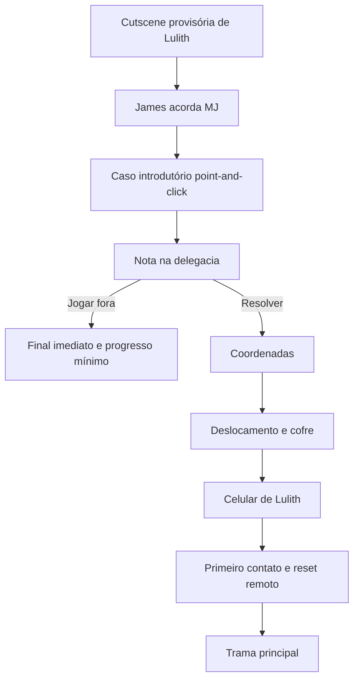
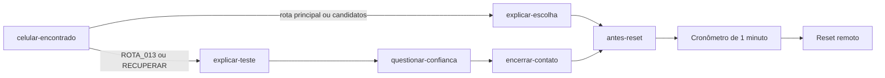
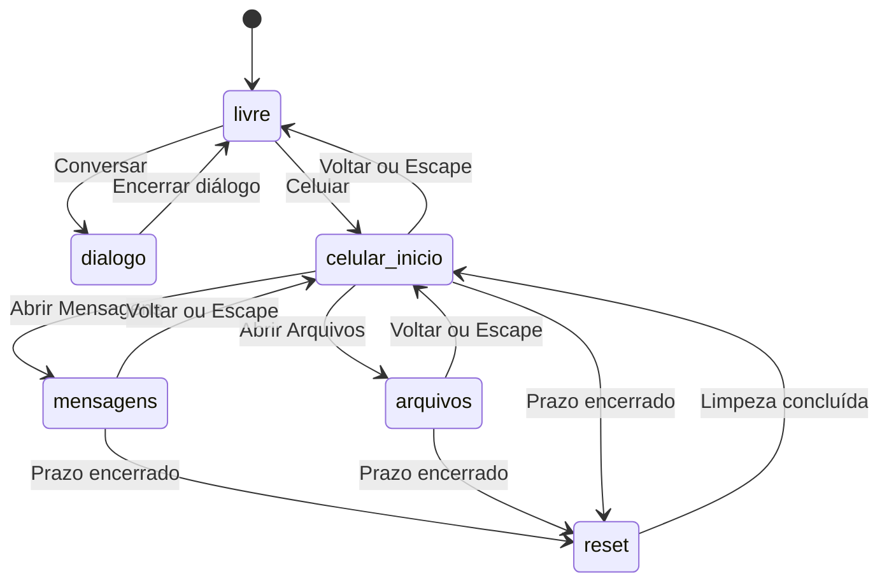

---
aliases:
  - Estrutura Gaming
  - Arquitetura do Jogo
  - Estado Atual do SANMD
tags:
  - sanmd
  - arquitetura
  - gameplay
  - roadmap
  - visual-novel
  - obsidian
status: atual
updated: 2026-09-03
---

# Estrutura Gaming

> [!summary] Objetivo
> Esta nota documenta o que funciona atualmente em **Sim, Acredite nas Mentiras Dele kk**, explica sua arquitetura e organiza a evolução do protótipo em formato de roadmap. O código é a fonte de verdade; recursos descritos no [[GDD]] que ainda não possuem implementação são identificados como planejamento.

## Navegação

- [[ESTRUTURA_GAMING#Visão Geral|Visão Geral]]
- [[ESTRUTURA_GAMING#Direção Conceitual Atual|Direção Conceitual Atual]]
- [[ESTRUTURA_GAMING#Roadmap Do Fluxo Atual|Roadmap Do Fluxo Atual]]
- [[ESTRUTURA_GAMING#Arquitetura Técnica|Arquitetura Técnica]]
- [[ESTRUTURA_GAMING#Máquina De Estados|Máquina De Estados]]
- [[ESTRUTURA_GAMING#Visual Novel E Diálogos|Visual Novel E Diálogos]]
- [[ESTRUTURA_GAMING#Interface Do Celular|Interface Do Celular]]
- [[ESTRUTURA_GAMING#Aplicativo Mensagens|Aplicativo Mensagens]]
- [[ESTRUTURA_GAMING#Timers E Ritmo|Timers E Ritmo]]
- [[ESTRUTURA_GAMING#Interface E Acessibilidade|Interface E Acessibilidade]]
- [[ESTRUTURA_GAMING#Execução E Android|Execução E Android]]
- [[ESTRUTURA_GAMING#Matriz De Funcionalidades|Matriz De Funcionalidades]]
- [[ESTRUTURA_GAMING#Limitações Atuais|Limitações Atuais]]
- [[ESTRUTURA_GAMING#Roadmap Futuro|Roadmap Futuro]]
- [[ESTRUTURA_GAMING#Validação Pendente|Validação Pendente]]

## Visão Geral

O projeto atual é um protótipo de Visual Novel investigativa feito com HTML, CSS e JavaScript. Ele possui uma única cena jogável, um sistema de diálogo, monólogos que mudam conforme o progresso e uma interface de celular usada como canal narrativo.

### O Que Funciona

- Cena noturna provisória.
- Sprite genérico e estático de MJ em SVG externo.
- Botões **Conversar** e **Celular**.
- Caixa de diálogo com efeito de digitação.
- Monólogos condicionados ao progresso da conversa.
- Tela inicial do celular com relógio e data reais.
- Aplicativo Mensagens funcional.
- Aplicativo Arquivos com primeiro enigma e registros opcionais anteriores ao reset.
- Respostas selecionáveis com ramificações curtas.
- Cooldown antes da primeira resposta do dono.
- Indicador `digitando...`.
- Entrega individual das mensagens do dono.
- Histórico do caminho escolhido durante a sessão.
- Primeiro contato canônico com Lulith e reset remoto do aparelho.
- Arquivamento interno das pistas vistas e do chat antes do reset.
- Rotas de conversa e monólogos condicionados aos arquivos examinados.
- Cronômetro vermelho de um minuto antes da limpeza remota.
- Navegação contextual pelo botão **Voltar** e pela tecla `Escape`.
- Layout responsivo básico para telas menores que `700px`.
- Estrutura Capacitor para geração do aplicativo Android.

### Escopo Atual

O protótipo valida a base da experiência, não o jogo completo. A interface do celular, a apresentação narrativa e a transição entre estados são o foco desta versão.

A cena ainda é um contexto provisório que começa com o celular em posse de MJ. A conversa, os monólogos, os arquivos anteriores ao reset e a limpeza remota já representam um recorte canônico da Fase 8 do Ato I; as etapas anteriores, da abertura à obtenção do aparelho, ainda não estão implementadas.

> [!warning] Fonte de verdade
> O [[IDEIA_CONCEITUAL]] registra as decisões narrativas mais recentes. O [[GDD]] organiza o design do jogo. Investigação, terminal, puzzles, múltiplos atos, finais, replay e ARG fazem parte da visão futura e não estão presentes no código atual.

## Direção Conceitual Atual

### Premissa Canônica Planejada

MJ é uma investigadora criminal/consultora técnica ligada à polícia em São Paulo. Após um caso introdutório, ela encontra uma nota na delegacia. Resolver seu enigma leva a coordenadas, a um cofre e ao celular de Lulith; jogar a nota fora encerra a partida imediatamente com progresso mínimo.



### Personagens Definidos

| Personagem | Função atual |
|---|---|
| MJ | Protagonista; nome escolhido pelo jogador; experiente em enigmas, ARGs e escape rooms |
| Lulith | Dona do celular e responsável por conduzir os testes |
| William James | Amigo, antigo professor e colega de trabalho de MJ |

O elenco terá no máximo seis personagens principais/relevantes. Não haverá romance entre MJ e Lulith.

### Sistemas Planejados Do Celular

| Aplicativo | Função planejada | Status atual |
|---|---|---|
| Mensagens | Conversas com Lulith e escolhas narrativas | Primeiro contato canônico e anônimo funcional |
| Galeria | Fotografias, gravações e pistas | Placeholder |
| Câmera | Registro e possível save por fotografia | Não implementado; conceito provisório |
| Notas | Informações contextuais | Placeholder |
| Arquivos | Documentos e conteúdo oculto | Quatro registros pré-reset; vazio após a limpeza |
| Terminal | Puzzles e acesso a informações escondidas | Não implementado |
| Mapa | Coordenadas, locais e deslocamento | Não implementado |
| Progresso | Percentual da investigação reconstruída | Não implementado |
| Salvamento/replay | Retomada e novas perspectivas | Não implementado |

### Direção Visual

A versão final manterá direção pixelada e personagens 2D expressivos. Os assets dos Protótipos 1 e 2 serão genéricos; o design canônico será fechado apenas no Protótipo 3. Os protótipos atuais usarão tudo em 2D, enquanto a dimensionalidade final dos cenários continua pendente.

## Roadmap Do Fluxo Atual

Este roadmap descreve a sequência que já funciona durante uma partida.

### Etapa 1 — Inicialização

1. `index.html` monta a cena, a barra lateral e o celular oculto.
2. `js/data.js` disponibiliza cena, monólogos e árvore de mensagens.
3. `js/game.js` cria o estado inicial em modo `livre`.
4. **Conversar** e **Celular** ficam disponíveis.

### Etapa 2 — Cena Livre

O jogador vê a sala e pode escolher uma das duas ações principais:

- **Conversar:** inicia uma interação local.
- **Celular:** abre o aparelho em uma camada sobre o cenário.

Enquanto um diálogo ou o celular está aberto, os dois botões principais ficam desabilitados.

### Etapa 3 — Monólogo Inicial

Como `DATA.cena.personagensPresentes` está vazio, **Conversar** não encontra um personagem presencial. O sistema usa o monólogo `inicial`, no qual o protagonista percebe que deve verificar o celular.

### Etapa 4 — Abertura Do Celular

O celular abre sempre na tela inicial e apresenta:

- Hora local.
- Data local.
- Sinal e bateria decorativos.
- Mensagens.
- Galeria.
- Notas.
- Arquivos.

**Mensagens** e **Arquivos** possuem comportamento implementado. Mensagens fica acessível desde o início. Três arquivos podem liberar opções condicionais durante a conversa; `REMETENTE.enc` aparece somente quando a conversa termina e o cronômetro do reset começa. Após a limpeza, os dois aplicativos continuam acessíveis, mas não exibem conteúdo.

### Etapa 5 — Primeira Mensagem Do Protagonista

Ao entrar em Mensagens pela primeira vez, nenhuma mensagem do dono é mostrada. O jogador escolhe entre as opções básicas e aquelas liberadas pelos arquivos examinados, e o protagonista envia a primeira mensagem.

Nesse momento:

- A escolha entra no histórico à direita.
- As opções são ocultadas.
- O monólogo muda para `aposPrimeiroEnvio`.
- Se a escolha for condicional, sua rota de monólogo é preservada sem poder ser substituída por outra rota individual.
- Começa um cooldown de 1 minuto.

### Etapa 6 — Resposta Do Dono

Quando o cooldown termina:

1. Aparece `digitando...`.
2. A primeira mensagem chega após 1,2 segundo.
3. As demais mensagens chegam individualmente.
4. Cada mensagem também respeita o intervalo de 1,2 segundo.
5. Ao terminar a fila, novas respostas do protagonista são liberadas.

### Etapa 7 — Ramificações Curtas

O jogador sempre pode seguir uma rota principal curta, mas arquivos específicos liberam opções e rotas adicionais. `CANDIDATOS_04.log` libera uma pergunta sobre candidatos; `ROTA_013.txt` libera a rota sobre a origem do aparelho; `RECUPERAR.tmp` libera uma cobrança direta. Essas rotas entregam informações diferentes antes de convergirem para `antes-reset`. O cabeçalho permanece como `???`, e o contato não revela nome, gênero ou dados pessoais.



### Etapa 8 — Conclusão

Depois da última resposta do contato:

- A etapa do chat passa a `null`.
- Nenhuma nova opção é apresentada.
- Um cronômetro vermelho de um minuto aparece no canto superior esquerdo do celular.
- O último arquivo fica disponível durante essa janela.
- O histórico e os IDs dos arquivos vistos são arquivados internamente quando o reset começa.
- Uma tela de reset bloqueia temporariamente a navegação.
- O histórico visível é apagado e Arquivos passa a exibir uma lista vazia.
- O monólogo muda para `conversaConcluida` somente depois que a limpeza termina.
- **Conversar** passa a apresentar a reflexão final do protagonista.

## Arquitetura Técnica

### Mapa De Arquivos

```text
.
├── index.html                 # Estrutura da cena e do celular
├── styles.css                 # Layout, animações e responsividade
├── js/
│   ├── data.js                # Conteúdo narrativo e árvore do chat
│   └── game.js                # Estado, regras e renderização
├── assets/                    # Arte provisória usada em runtime
├── android/                   # Projeto nativo Android
├── capacitor.config.json      # Configuração Capacitor
├── package.json               # Scripts e dependências
├── README.md                  # Visão geral do projeto
├── TODO.md                    # Implementação e validações pendentes
├── IDEIA_CONCEITUAL.md        # Decisões narrativas e visuais mais recentes
├── GDD.md                     # Visão de longo prazo do jogo
└── ESTRUTURA_GAMING.md        # Esta nota central
```

### Camadas

| Camada | Arquivo | Responsabilidade |
|---|---|---|
| Estrutura | [index.html](index.html) | Cena, controles, celular e regiões acessíveis |
| Apresentação | [styles.css](styles.css) | Visual, animações, balões e responsividade |
| Dados | [js/data.js](js/data.js) | Cena, monólogos, etapas e respostas |
| Domínio | [js/game.js](js/game.js) | Estado, timers, navegação e renderização |
| Distribuição | [capacitor.config.json](capacitor.config.json) | Empacotamento web para Android |

### Princípio Atual

Não há framework de interface, bundler ou backend. O navegador carrega os scripts diretamente. O estado existe somente em memória e o DOM é atualizado por funções em `js/game.js`.

## Máquina De Estados

### Estado Principal



`state.modo` controla os modos globais:

- `livre`.
- `dialogo`.
- `celular`.

### Estado Agrupado

O estado é dividido por domínio:

```js
const state = {
  modo: "livre",
  dialogo: {},
  celular: {},
  arquivos: {},
  mensagens: {}
};
```

### Estado Do Diálogo

| Propriedade | Uso |
|---|---|
| `linha` | Índice da fala atual |
| `digitando` | Indica se o efeito de texto está ativo |
| `timer` | Intervalo do efeito de digitação |
| `falas` | Sequência em execução |
| `faseMonologo` | Seleciona o monólogo narrativo atual |
| `rotaMonologoArquivo` | Preserva a primeira rota condicional escolhida |

### Estado Do Celular

| Propriedade | Uso |
|---|---|
| `tela` | `inicio`, `mensagens`, `arquivos` ou `reset` |
| `relogio` | Intervalo de atualização da hora |
| `transicao` | Timer da animação de fechamento |
| `resetTimer` | Timer para início ou conclusão da limpeza |
| `resetInterval` | Intervalo visual do cronômetro |
| `resetAte` | Horário absoluto do início do reset |
| `resetStatus` | `inativo`, `agendado`, `executando` ou `concluido` |

### Estado Dos Arquivos

| Propriedade | Uso |
|---|---|
| `vistos` | IDs examinados durante a sessão |
| `vistosAntesReset` | Snapshot dos IDs examinados antes da limpeza |
| `enigmaIdentidadeResolvido` | Controla pronome e rota completa |
| `enigmaIdentidadeResolvidoAntesReset` | Preserva a solução no snapshot pré-reset |

### Estado Das Mensagens

| Propriedade | Uso |
|---|---|
| `etapa` | Etapa atual do chat |
| `historico` | Mensagens do caminho percorrido |
| `donoRespondendo` | Bloqueia escolhas durante a resposta |
| `donoDigitando` | Controla o indicador de digitação |
| `fila` | Mensagens ainda não entregues |
| `proximaEtapa` | Destino após a fila |
| `cooldownAte` | Horário absoluto do fim do cooldown |
| `timer` | Timer do cooldown ou do próximo envio |
| `historicoAntesReset` | Preserva internamente o chat apagado pelo reset |

## Visual Novel E Diálogos

### Seleção Da Interação

`iniciarConversa()` consulta o primeiro item de `DATA.cena.personagensPresentes`.

- Se existir um personagem, procura uma conversa em `DATA.conversas.presenciais`.
- Se não existir, usa o monólogo da fase atual.

Atualmente:

```js
personagensPresentes: []
conversas: {
  presenciais: {}
}
```

Portanto, somente os monólogos são jogáveis.

### Efeito De Digitação

- Cada caractere aparece em intervalo de 22 ms.
- Um clique durante a animação completa a frase.
- Outro clique avança para a próxima fala.
- `Enter` e espaço possuem o mesmo comportamento.
- Uma seta aparece quando a fala está pronta para avançar.

### Monólogos Por Progresso

| Fase | Momento |
|---|---|
| `inicial` | Antes de resolver o enigma; MJ presume um dono masculino |
| `identidadeResolvida` | Depois de decodificar `5-12-1` como `ELA` |
| `aposPrimeiroEnvio` | Depois da primeira escolha do protagonista |
| `arquivoCandidatos` | Primeira resposta condicional relacionada a `CANDIDATOS_04.log` |
| `arquivoRota` | Primeira resposta condicional relacionada a `ROTA_013.txt` |
| `arquivoRecuperar` | Primeira resposta condicional relacionada a `RECUPERAR.tmp` |
| `todosArquivos` | Os quatro arquivos foram examinados e `REMETENTE.enc` foi resolvido |
| `conversaConcluida` | Depois da última resposta do dono |

A primeira resposta condicional fixa uma única rota individual, mesmo que outros arquivos tenham sido vistos. Isso impede a mistura de informações e incentiva novas partidas. A rota `todosArquivos` tem prioridade sobre a individual e continua disponível depois do reset porque os IDs examinados permanecem registrados internamente.

> [!info] Sprite e presença narrativa
> O sprite genérico de MJ permanece visível na cena, mas `personagensPresentes` está vazio. `personagensVisuais` controla somente a presença gráfica; por isso, exibir MJ não cria uma conversa presencial inexistente.

## Interface Do Celular

### Abertura

`abrirCelular()`:

- Altera o modo para `celular`.
- Restaura a tela inicial.
- Exibe o overlay animado.
- Atualiza hora e data.
- Inicia o relógio a cada segundo.
- Move o foco para Mensagens.

### Navegação

O botão **Voltar** utiliza a tela atual:

- `mensagens` → `inicio`.
- `inicio` → fecha o celular.

Ao fechar o aparelho:

- O relógio é interrompido.
- O timer de mensagens é cancelado.
- O progresso narrativo permanece em memória.
- O foco retorna ao botão **Celular**.

### Aplicativos

| Aplicativo | Status |
|---|---|
| Mensagens | Funcional |
| Galeria | Placeholder sem ação |
| Notas | Placeholder sem ação |
| Arquivos | Quatro registros antes do reset; aplicativo vazio após a limpeza |

## Aplicativo Mensagens

### Estrutura Do DOM

```html
<section id="phone-messages" aria-labelledby="messages-header">
  <header id="messages-header">???</header>
  <div id="messages-list" aria-live="polite"></div>
  <div id="messages-choices" role="group" aria-label="Escolha uma resposta"></div>
</section>
```

### Modelo Narrativo

```js
mensagens: {
  dono: {
    inicio: "celular-encontrado",
    abertura: [],
    etapas: {
      etapaId: {
        recebidas: [],
        opcoes: [
          {
            id: "opcao-id",
            texto: "Mensagem do protagonista",
            resposta: ["Resposta do dono"],
            proxima: "outra-etapa"
          }
        ]
      }
    }
  }
}
```

### Regras Das Etapas

- Cada etapa possui entre uma e três opções.
- Cada opção possui identificador único.
- `texto` é enviado pelo protagonista.
- `resposta` contém a reação específica do dono.
- `proxima` aponta para outra etapa.
- `proxima: null` encerra a conversa.
- As opções não selecionadas não entram no histórico.

### Etapas Existentes

| Etapa | Opções | Resultado |
|---|---:|---|
| `celular-encontrado` | Variável | Opções e destinos dependem dos arquivos examinados |
| `explicar-escolha` | 2 | Converge para `antes-reset` |
| `explicar-teste` | 2 | Rota condicional que revela informações sobre o teste |
| `questionar-confianca` | 1 | Continua a rota condicional |
| `encerrar-contato` | 2 | Converge para `antes-reset` |
| `antes-reset` | 2 | Encerra em `null` e agenda o reset remoto |

### Responsabilidades Principais

| Função | Responsabilidade |
|---|---|
| `obterEtapaMensagem()` | Acessa uma etapa da árvore |
| `adicionarMensagem()` | Insere uma entrada no histórico |
| `prepararEnvioDono()` | Configura fila, destino e cooldown |
| `agendarEnvioDono()` | Agenda cooldown ou próxima entrega |
| `enviarProximaMensagemDono()` | Entrega apenas uma mensagem |
| `finalizarEnvioDono()` | Libera opções ou conclui o chat |
| `escolherResposta()` | Registra a escolha do jogador |
| `renderizarMensagens()` | Atualiza balões e indicador |
| `renderizarEscolhas()` | Cria os botões da etapa atual |

## Timers E Ritmo

Os valores ficam centralizados em `CONFIG`:

```js
const CONFIG = Object.freeze({
  velocidadeDigitacao: 22,
  intervaloMensagemDono: 1200,
  cooldownPrimeiraResposta: 60 * 1000,
  transicaoCelular: 280,
  esperaAntesReset: 60 * 1000,
  duracaoReset: 2800
});
```

### Cooldown Inicial

- Só ocorre depois da primeira mensagem do protagonista.
- Dura 1 minuto.
- Durante o cooldown, as escolhas ficam ocultas.
- O indicador de digitação ainda não aparece.
- O prazo é salvo como horário absoluto em `cooldownAte`.

### Entrega Sequencial

- Depois do cooldown, `digitando...` é exibido.
- Cada mensagem do dono é removida individualmente da fila.
- O intervalo entre entregas é de 1,2 segundo.
- Depois da última mensagem, a próxima etapa é ativada.

### Cronômetro Do Reset

- Começa quando a conversa chega a `null`.
- Exibe `01:00` em vermelho no canto superior esquerdo do celular.
- Atualiza durante a janela de resolução do último arquivo.
- Exibe `00:00` quando a limpeza remota começa.
- Desaparece e restaura o indicador de sinal quando o reset termina.

### Retomada

Se o celular for fechado durante o cooldown, o timer é cancelado, mas o horário final permanece. Ao retornar a Mensagens, o código calcula o tempo restante.

> [!note] Persistência limitada
> Histórico, cooldown e progresso sobrevivem à navegação interna, mas não a um recarregamento, fechamento do navegador ou encerramento do aplicativo.

## Interface E Acessibilidade

### Responsividade Implementada

Em telas menores que `700px`:

- A interface principal muda de linha para coluna.
- A barra lateral vira uma barra inferior.
- Título e versão são ocultados.
- Botões principais dividem a largura.
- O celular é reduzido.
- Balões podem ocupar até 84% da largura.
- A área de escolhas recebe mais espaço vertical.

### Recursos De Acessibilidade

- Ações interativas usam `button`.
- As escolhas possuem `role="group"`.
- A região de histórico usa `aria-live="polite"`.
- As escolhas possuem estilo de `:focus-visible`.
- O foco é movido em transições importantes.
- Mensagens são inseridas com `textContent`.

### Pontos Ainda Não Validados

- Navegação completa somente por teclado.
- Leitores de tela.
- Contraste formal.
- Zoom e fontes ampliadas.
- Orientação paisagem.
- Safe areas e recortes de tela.
- `prefers-reduced-motion`.
- Trava de foco dentro do overlay.

## Execução E Android

### Web Local

```bash
python3 -m http.server 8000
```

Abrir `http://localhost:8000`.

### Scripts

| Comando | Função |
|---|---|
| `npm run copy:web` | Recria `www` com os arquivos web |
| `npm run sync` | Copia a web e sincroniza o Android |
| `npm run apk` | Sincroniza e gera o APK de debug |
| `npm test` | Executa a suíte Node de caracterização e domínio |

### Capacitor

| Configuração | Valor |
|---|---|
| App ID | `com.sanmd.game` |
| Nome | `SANMD` |
| Diretório web | `www` |
| Capacitor | 8.5.0 |
| Android mínimo | SDK 24 |
| Android alvo | SDK 36 |
| Java | 21 |
| Node.js | 22 ou superior |

> [!warning] Build Android
> A estrutura Android existe, mas o APK e os testes Android ainda precisam de validação. O teste instrumentado padrão também referencia um pacote diferente de `com.sanmd.game` e deve ser corrigido.

## Matriz De Funcionalidades

| Recurso | Status | Observação |
|---|---|---|
| Cena noturna | Implementado | Estática e provisória |
| Sprite genérico de MJ | Implementado | SVG externo, pose neutra estática e design não canônico |
| Conversar | Implementado | Executa monólogos na cena atual |
| Diálogo digitado | Implementado | Clique, `Enter` e espaço |
| Monólogos por progresso | Implementado | Fases gerais, três rotas individuais e uma rota completa |
| Conversa presencial | Parcial | Motor existe, conteúdo não |
| Celular | Implementado | Overlay com tela inicial |
| Relógio e data | Implementado | Valores locais |
| Mensagens | Implementado | Primeiro contato canônico e anônimo com opções condicionais por arquivo |
| Respostas selecionáveis | Implementado | Opções básicas e adicionais liberadas por pistas examinadas |
| Cooldown inicial | Implementado | 1 minuto |
| Entrega sequencial | Implementado | Uma mensagem por vez |
| Histórico na sessão | Implementado | Somente em memória |
| Voltar e Escape | Implementado | Navegação contextual web |
| Responsividade | Parcial | CSS existe; validação pendente |
| Capacitor Android | Parcial | Configurado; build pendente |
| Galeria | Placeholder | Sem ação |
| Notas | Placeholder | Sem ação |
| Arquivos | Parcial | Quatro registros pré-reset; acessível e vazio após a limpeza |
| Reset remoto | Implementado | Arquiva pistas e chat, limpa o acesso normal e restaura a tela inicial |
| Puzzle de identidade | Implementado | `5-12-1` deve ser decodificado como `ELA` durante o cronômetro |
| Persistência permanente | Não implementado | Sem save/localStorage |
| Investigação | Não implementado | Planejado no GDD |
| Puzzles | Parcial | Enigma de identidade implementado; sistema geral ainda planejado |
| Terminal | Não implementado | Planejado no GDD |
| Múltiplas cenas | Não implementado | Planejado no GDD |
| Finais e replay | Não implementado | Planejado no GDD |
| ARG | Não implementado | Planejado no GDD |

> [!note] Compatibilidade conceitual
> Os motores de diálogo, monólogo e Mensagens podem ser reaproveitados. O recorte do celular, do primeiro contato e do reset já segue a direção canônica; a cena e o sprite genérico de MJ ainda não representam as etapas anteriores do Ato I descritas em [[IDEIA_CONCEITUAL]].

## Limitações Atuais

### Narrativa

- Existe somente uma cena.
- Não há personagens presenciais cadastrados.
- Todas as ramificações convergem para o mesmo fluxo.
- O contato permanece como `???` durante toda a primeira conversa.
- Não existem finais distintos.

### Sistemas

- Estado volátil sem save/load.
- Sem gerenciamento de múltiplas partidas.
- Sem sistema de inventário ou evidências.
- Sem eventos de cenário.
- Sem áudio.
- Sem investigação point-and-click, terminal ou sistema geral de puzzles; existe apenas o enigma de identidade do celular.

### Interface

- Galeria e Notas permanecem visíveis como planejamento, mas estão desabilitadas e identificadas como indisponíveis.
- O overlay não possui trava completa de foco.
- O botão físico Voltar do Android não possui tratamento específico.
- Bateria e sinal são decorativos.

### Qualidade

- A suíte automatizada possui onze testes para fluxo, dados, 14 escolhas, opções condicionais, pronomes, monólogos, cronômetro e reset da Fase 8, além de três testes do contrato visual da MJ genérica; os demais sistemas ainda não possuem cobertura.
- Não existe CI.
- Responsividade e acessibilidade dependem de validação manual.
- O APK ainda não foi validado ponta a ponta.

## Roadmap Futuro

O roadmap abaixo separa evolução técnica imediata da visão narrativa do [[GDD]].

### Fase 0 — Fundação Atual

Status: **implementada**.

- [x] Cena base.
- [x] Visual Novel e diálogo digitado.
- [x] Celular e navegação contextual.
- [x] Mensagens ramificadas.
- [x] Cooldown e entrega sequencial.
- [x] Monólogos por progresso.
- [x] Configuração Capacitor.

### Fase 1 — Estabilização Da V1

Status: **próxima prioridade**.

- [ ] Validar todos os caminhos do chat.
- [ ] Criar testes automatizados para a máquina de estados.
- [ ] Validar responsividade em diferentes resoluções.
- [ ] Validar teclado, toque e leitor de tela.
- [ ] Corrigir teste instrumentado Android.
- [ ] Gerar e testar APK de debug.
- [ ] Tratar o botão físico Voltar no Android.

### Fase 2 — Adaptação Conceitual

Status: **planejada**.

- [ ] Trocar o conteúdo atual para MJ, Lulith e William James.
- [ ] Permitir a escolha do nome real de MJ.
- [ ] Prototipar a cutscene de Lulith e a cena de dormitório.
- [ ] Criar o caso introdutório de investigação point-and-click.
- [ ] Criar a delegacia, a nota e a escolha que permite encerrar a partida.
- [ ] Implementar coordenadas, deslocamento, cofre e obtenção do celular.
- [x] Adaptar o chat atual para o primeiro contato com Lulith.
- [x] Implementar o reset remoto do aparelho.

### Fase 3 — Persistência E Aplicativos

Status: **planejada**.

- [ ] Salvar histórico e progresso.
- [ ] Restaurar sessão após fechar o jogo.
- [ ] Implementar Galeria.
- [ ] Implementar Câmera e avaliar save por fotografias.
- [ ] Implementar Notas.
- [x] Implementar o recorte pré-reset de Arquivos.
- [ ] Expandir Arquivos para os documentos dos atos posteriores.
- [ ] Implementar Mapa.
- [ ] Implementar indicador de Progresso.
- [ ] Cadastrar personagens e conversas presenciais.
- [ ] Adicionar novas cenas.

### Fase 4 — Investigação E Puzzles

Status: **visão do GDD**.

- [ ] Objetos clicáveis.
- [ ] Evidências.
- [ ] Navegação por mapa.
- [ ] Pistas ambientais.
- [ ] Puzzles.
- [ ] Terminal hacker.

### Fase 5 — Estrutura Narrativa Completa

Status: **visão do GDD**.

- [ ] Múltiplos atos.
- [ ] Definir e implementar o clímax.
- [ ] Finais como perspectivas diferentes de MJ.
- [ ] Replay narrativo.
- [ ] Progresso de 100%.
- [ ] Final verdadeiro associado à reconstrução completa.
- [ ] Camadas metalinguísticas.
- [ ] Integração ARG.

### Fase 6 — Direção Visual Definitiva

Status: **planejada para o Protótipo 3**.

- [ ] Consolidar o design de MJ, Lulith e James.
- [ ] Consolidar os demais personagens principais.
- [ ] Substituir sprites e cenários genéricos.
- [ ] Definir a solução final 2D, 3D tratado ou híbrida para os cenários.
- [ ] Manter a leitura pixelada e os sprites 2D expressivos.

## Validação Pendente

- [x] Validar estruturalmente e processar as 14 opções cadastradas.
- [x] Confirmar que todas as respostas específicas entram na fila correta.
- [ ] Confirmar o cooldown real de 1 minuto.
- [ ] Fechar e reabrir o celular durante o cooldown.
- [ ] Confirmar entrega individual de todas as mensagens.
- [ ] Validar todas as fases e rotas de monólogo nos momentos corretos.
- [ ] Testar clique, `Enter`, espaço e `Escape`.
- [ ] Testar teclado, mouse e toque no chat.
- [ ] Testar larguras abaixo e acima de `700px`.
- [ ] Testar orientação paisagem.
- [ ] Validar contraste e foco.
- [ ] Executar `npm run sync` em ambiente Android configurado.
- [ ] Gerar e instalar o APK de debug.

## Referências

- [[README]] — visão geral e execução.
- [[TODO]] — tarefas concluídas e pendentes.
- [[GDD]] — visão narrativa e mecânicas futuras.
- [[IDEIA_CONCEITUAL]] — decisões conceituais e pendências atuais.
- [index.html](index.html) — estrutura atual.
- [styles.css](styles.css) — apresentação atual.
- [js/data.js](js/data.js) — dados narrativos atuais.
- [js/game.js](js/game.js) — regras e estado atuais.

> [!tip] Uso No Obsidian
> Use esta nota como índice técnico principal. As seções podem ser transformadas em notas independentes no futuro e conectadas por links wiki sem alterar a organização conceitual.
